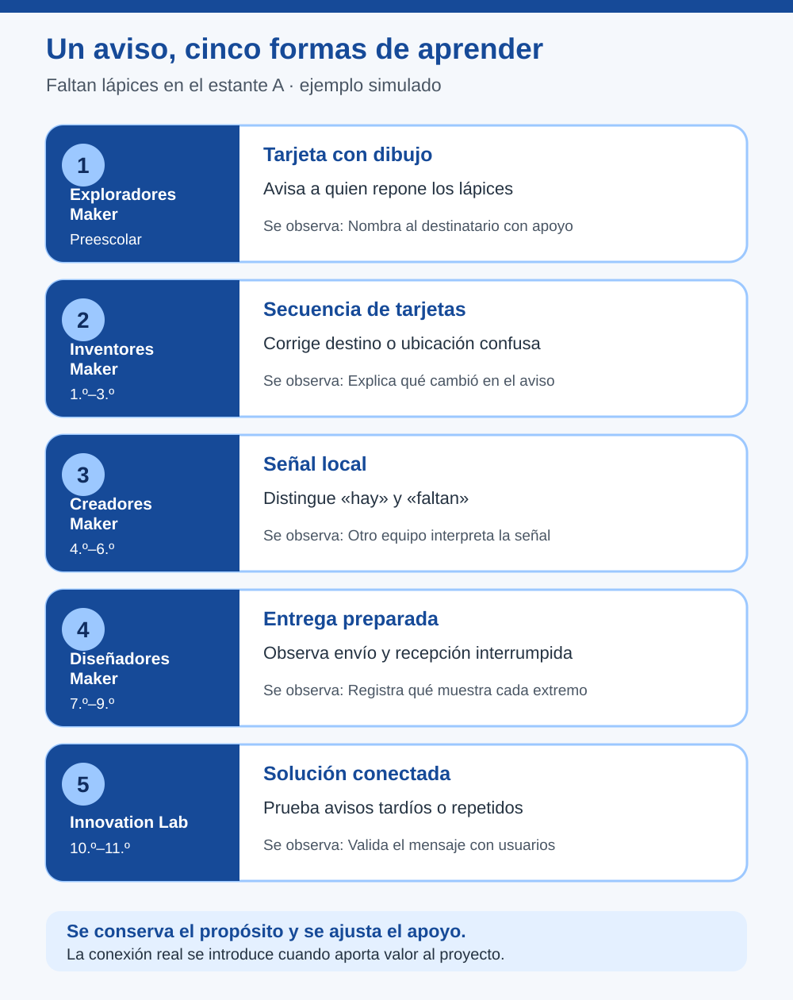

# Mapa de Progresión de IoT y Conectividad: orientación docente

> Este archivo pertenece a: **IoT y Conectividad**  
> Ruta: `01. Bloques Temáticos/06. IoT y Conectividad/01. Mapa de Progresión.md`

---

## Estado

**Estado:** En revisión  
**Versión:** v1.3

**Bloque:** 06_iot-conectividad  
**Última actualización:** 2026-10-20

---

## Descripción

Este mapa orienta la adaptación del bloque de IoT y Conectividad según los cinco niveles institucionales de Maker Academy. Relaciona preparación conceptual, profundidad técnica, autonomía y evidencias. Incluye aplicaciones al capítulo Mensajes entre objetos y datos confiables, a la carpeta ESP32 y a las prácticas guiadas.

Su función es ayudar al personal docente a decidir qué trabajar y con qué apoyos. No asigna las mismas herramientas a todos los grados ni sustituye el Programa Anual K-11 o una planificación de experiencia.

---

## Propósito

Orientar decisiones de mediación para conservar el propósito de una experiencia IoT mientras se ajustan lenguaje, componentes, programación, comunicación y validación al nivel, los conocimientos previos y los recursos disponibles.

---

## Contenido

### 1. Base institucional de la progresión

La progresión de Maker Academy avanza de lo concreto a lo abstracto, de lo guiado a lo autónomo, de componentes aislados a sistemas integrados, de observaciones informales a validación y de creaciones personales a soluciones con impacto.

Para el bloque 06, la progresión institucional establece:

- **Niveles 1 y 2:** IoT no se prioriza. Se trabajan bases de causa y efecto, secuencias y comunicación con recursos apropiados.
- **Nivel 3:** preparación mediante sensores y datos.
- **Nivel 4:** aproximaciones iniciales cuando sean pertinentes.
- **Nivel 5:** conectividad, plataformas, intercambio y visualización de datos, principalmente en Innovation Lab.

Los ajustes que siguen concretan esa orientación para la mediación. No incorporan nuevos requisitos obligatorios por grado ni convierten la programación de ESP32 en una expectativa de preescolar o primaria inicial.

### 2. Cómo seleccionar el punto de entrada

Antes de elegir código o hardware, observe:

1. **Propósito:** ¿puede el grupo explicar qué necesidad aborda y quién usará el resultado?
2. **Datos:** ¿distingue un valor, su unidad, un dato simulado y uno ausente?
3. **Sistema local:** ¿relaciona una entrada, un proceso y una salida?
4. **Prueba:** ¿puede anticipar un resultado, observarlo y registrar una mejora?
5. **Responsabilidad:** ¿reconoce cuidados de conexiones y datos que no deben compartirse?

No use estas preguntas como examen de acceso. Sirven para identificar apoyos: diagramas, vocabulario visual, montaje preparado, datos ficticios, código base o mentoría técnica.

El grado orienta la expectativa curricular; el diagnóstico orienta el acompañamiento. Un estudiante de Nivel 5 puede necesitar apoyo técnico inicial sin perder la oportunidad de tomar decisiones sobre usuarios, privacidad e impacto.

### 3. Progresión por nivel

| Nivel institucional | Aprendizaje central del bloque | Mediación |
| --- | --- | --- |
| **1. Exploradores Maker — Preescolar** | Observar causa y efecto y representar una señal con propósito. | Acompañamiento constante; manipulación y demostración docente. |
| **2. Inventores Maker — 1.º–3.º** | Ordenar secuencias y explicar a quién comunica una creación. | Opciones guiadas, símbolos y montaje preparado. |
| **3. Creadores Maker — 4.º–6.º** | Relacionar sensores, respuestas locales y datos con unidad. | Programación por bloques compatible, preguntas y criterios de prueba. |
| **4. Diseñadores Maker — 7.º–9.º** | Integrar componentes y explorar una conexión pertinente con diagnóstico. | Acompañamiento estratégico, recursos preparados y decisiones justificadas. |
| **5. Innovation Lab — 10.º–11.º** | Diseñar una solución conectada para usuarios, probarla y analizar su impacto. | Mentoría, autonomía creciente y revisión de decisiones críticas. |

#### Evidencias y criterio de avance

| Nivel | Evidencias apropiadas | Señal de comprensión para ampliar |
| --- | --- | --- |
| 1 | Dibujo, representación y explicación oral. | Relaciona una acción con una señal. |
| 2 | Secuencia visual, boceto y demostración guiada. | Explica mensaje, destinatario y un cambio realizado. |
| 3 | Diagrama, código por bloques, tabla o gráfico. | Explica dato, unidad, respuesta y una mejora. |
| 4 | Código o configuración, registro de fallos y diagrama. | Distingue circuito, red y aplicación al analizar un fallo. |
| 5 | Repositorio, validación con usuarios y análisis de datos. | Justifica tecnología, acceso, recuperación y límites. |

“Ampliar” puede significar mejorar la explicación, la documentación o la autonomía. No implica necesariamente incorporar una nueva herramienta o avanzar al currículo de otro grado.

### 4. Qué se ajusta y qué se conserva

| Dimensión | Ajuste de menor a mayor profundidad |
| --- | --- |
| Representación | Objetos y tarjetas → diagramas funcionales → arquitectura. |
| Datos | Estados visibles → valores con unidad → calidad, frecuencia y vigencia. |
| Programación | Secuencias → bloques y condiciones → integración y depuración. |
| Comunicación | Señal representada para alguien → aviso local claro → entrega e interpretación probadas → intercambio conectado cuando aporta valor. |
| Autonomía | Elección entre opciones → planificación guiada → decisiones y validación. |
| Fallos | Mensaje que no llega → interrupción observada → recuperación y análisis. |
| Documentación | Explicación visual → bitácora de versiones → repositorio trazable. |

**Se conserva en todos los niveles:** propósito comprensible, seguridad, cuidado de la privacidad, colaboración, oportunidad de probar y reflexión sobre lo aprendido. El lenguaje cambia, pero esos criterios no se eliminan.

### 5. Aplicación a Mensajes entre objetos, datos confiables y ESP32

#### Mensajes entre objetos

En [Mensajes entre objetos](04.%20Protocolos%20de%20Comunicaci%C3%B3n/README.md), el aprendizaje que se conserva es **comunicar un estado útil a un destinatario y comprobar qué entendió**. El caso del estante A se adapta así:

| Nivel | Alcance pertinente | Evidencia para decidir el siguiente paso |
| --- | --- | --- |
| 1. Exploradores Maker | Representar con dibujos que faltan lápices y entregar el aviso a quien los repone. | Identifica, con apoyo, quién necesita la señal. |
| 2. Inventores Maker | Ordenar la secuencia y corregir una tarjeta que llega a otra mesa o no indica el lugar. | Explica destinatario y cambio realizado. |
| 3. Creadores Maker | Relacionar dos estados simulados con avisos distintos; probar un indicador local. | Otro equipo interpreta el aviso y el grupo registra una mejora. |
| 4. Diseñadores Maker | Observar ambos extremos de una entrega preparada y una interrupción controlada. | Distingue cambio en el origen, recepción y ausencia de actualización. |
| 5. Innovation Lab | Diseñar el intercambio pertinente, probar aviso tardío o repetido y validar con usuarios. | Justifica qué confirma la interfaz, qué sigue incierto y cómo mejoró el mensaje. |

Los niveles 1 y 2 trabajan una representación, sin exigir dispositivos conectados. En el nivel 3 se pueden probar estados y señales locales. La conexión se introduce en el nivel 4 si ayuda a resolver una necesidad; en el nivel 5 se elige y valida como parte del proyecto. Los recursos de [mensaje con propósito](04.%20Protocolos%20de%20Comunicaci%C3%B3n/mensaje-con-proposito.md), [entrega](04.%20Protocolos%20de%20Comunicaci%C3%B3n/del-emisor-al-receptor.md) e [interpretación](04.%20Protocolos%20de%20Comunicaci%C3%B3n/llego-y-se-entendio.md) pueden utilizarse con distintos apoyos.

#### Datos confiables

En [Datos confiables: ¿podemos creerle al sensor?](04.%20Protocolos%20de%20Comunicaci%C3%B3n/datos-confiables.md), el grupo aprende a separar lo que mostró un instrumento de una conclusión sobre el entorno. Las lecturas de temperatura del ejemplo son simuladas; en los primeros niveles se sustituyen por comparaciones visuales y observaciones con apoyo.

| Nivel | Alcance pertinente | Evidencia para decidir el siguiente paso |
| --- | --- | --- |
| 1. Exploradores Maker | Comparar imágenes u observaciones de dos lugares y señalar dónde se miraría de nuevo. | Reconoce con apoyo que el lugar influye en lo observado. |
| 2. Inventores Maker | Ordenar «observé → dudé → revisé → avisé» con tarjetas; distinguir dato ausente de cero. | Pregunta qué información falta antes de contar lo ocurrido. |
| 3. Creadores Maker | Comparar tres lecturas preparadas con nombre y unidad; marcar una discrepancia. | Propone una comprobación y conserva la primera lectura en el registro. |
| 4. Diseñadores Maker | Revisar unidad, ubicación y momento en un conjunto de lecturas o con un instrumento preparado. | Contrasta una hipótesis y explica qué conclusión permite la evidencia. |
| 5. Innovation Lab | Definir criterios de validez para un proyecto y probar qué comunica la interfaz ante datos ausentes o dudosos. | Documenta una decisión, su incertidumbre y el efecto en las personas usuarias. |

El objetivo compartido es comunicar lo que se sabe con honestidad. El uso de un sensor real depende de la preparación del grupo y del proyecto; una lectura diferente motiva una prueba, no se descarta por parecer extraña.

#### ESP32

En niveles 1 y 2, los conceptos se pueden representar sin manipular ni programar la placa. En el nivel 3, el foco es el sistema local y sus datos. La configuración de redes y servicios aparece como exploración pertinente en el nivel 4 y como decisión de proyecto en el nivel 5.

| Tema | Preparación: niveles 1–3 | Introducción: Nivel 4 | Profundización: Nivel 5 |
| --- | --- | --- | --- |
| [Introducción al ESP32](03.%20ESP32/introduccion-esp32.md) | Causa y efecto; secuencia; entrada, proceso y salida. | Pinout, montaje, programa y diagnóstico. | Selección de placa y entorno según requisitos. |
| [Wi-Fi básico](03.%20ESP32/wifi-basico.md) | Representar mensajes; distinguir dato presente y ausente. | Conexión autorizada y prueba de interrupción. | Justificar STA/AP y diseñar recuperación. |
| [Bluetooth básico](03.%20ESP32/bluetooth-basico.md) | Comunicación cercana; observar dato con unidad y origen. | Descubrir, conectar y leer una característica. | Contrato de datos, permisos y compatibilidad. |
| [Servidor web](03.%20ESP32/servidor-web-embebido.md) | Consultar y cambiar; boceto; estado observado. | Rutas, respuestas y una interfaz preparada. | Validación, acceso, límites y pruebas con usuarios. |

La columna de preparación no exige completar todos los temas ni utilizar radio en primaria. La persona docente selecciona solo los elementos pertinentes al proyecto y a las bases que el grupo está construyendo.

Los programas de referencia usan C++ con Arduino-ESP32 para preparar demostraciones técnicas. La progresión institucional de programación se mantiene: bloques e introducción a Python según nivel, con Python e integración en niveles superiores. Un centro puede adaptar las demostraciones a un entorno compatible y probado; la equivalencia pedagógica está en el comportamiento comprendido y documentado.

#### Prácticas guiadas

Las [cinco prácticas](05.%20Pr%C3%A1cticas%20Guiadas/README.md) comparten una forma de trabajar: una persona necesita información o una respuesta; el grupo hace una primera versión, la prueba en condiciones normales y de fallo, escucha cómo la interpreta otra persona y la mejora. La profundidad técnica cambia con el nivel.

| Práctica | Preparación: niveles 1–3 | Introducción: nivel 4 | Profundización: nivel 5 |
| --- | --- | --- | --- |
| [Un aviso que sí llega](05.%20Pr%C3%A1cticas%20Guiadas/un-aviso-que-si-llega/README.md) | Tarjeta, señal local y destinatario. | Entrega preparada e interrupción. | Validación del aviso con usuarios. |
| [Tablero de temperatura](05.%20Pr%C3%A1cticas%20Guiadas/dashboard-temperatura/README.md) | Ordenar lecturas; añadir unidad, lugar y momento en nivel 3. | Mostrar vigencia y dato ausente en una interfaz preparada. | Justificar frecuencia y probar interpretación. |
| [Control local de LED](05.%20Pr%C3%A1cticas%20Guiadas/control-led-web/README.md) | Secuencia de petición y respuesta; LED local en nivel 3. | Distinguir solicitud, respuesta y salida física. | Decidir autorización, apagado y verificación. |
| [Sensor a registro remoto](05.%20Pr%C3%A1cticas%20Guiadas/sensor-a-nube/README.md) | Comparar listas ficticias de datos enviados y recibidos. | Diagnosticar un corte en una demostración preparada. | Integrar un servicio autorizado y documentar huecos. |
| [Alerta ambiental](05.%20Pr%C3%A1cticas%20Guiadas/alerta-ambiental-iot/README.md) | Representar a quién avisar; comparar lecturas en nivel 3. | Simular reglas y pérdida de actualización. | Validar la regla, mensaje y recuperación con usuarios. |

La columna de preparación describe **antecedentes**, no obliga a realizar cinco proyectos IoT en primaria. Elija una práctica según la necesidad y el tiempo; una tarjeta o tabla bien probada puede ser la experiencia completa.

### 6. Un mismo propósito a través de los niveles

**Propósito común:** avisar a la mesa de materiales que faltan lápices en el estante A. El estado es ficticio y no registra quién usa los materiales.

| Nivel | Propuesta de adaptación | Pregunta para mediar |
| --- | --- | --- |
| 1 | Tarjeta con dibujo y roles de estante, mensajero y mesa. | ¿A quién le sirve esta señal? |
| 2 | Secuencia visual y corrección de un aviso entregado a otra mesa. | ¿Cómo sabemos adónde llevarlo? |
| 3 | Botón o estado simulado con una señal local «hay / faltan». | ¿Qué muestra cada estado? |
| 4 | Dos extremos preparados; comparar una entrega y una interrupción. | ¿Se actualizó también el receptor? |
| 5 | Elegir la comunicación y validar avisos normales, repetidos y atrasados con usuarios. | ¿Qué puede afirmar la interfaz y qué queda por comprobar? |

En cada adaptación, el docente conserva la necesidad, selecciona una profundidad alcanzable y define la Evidencia antes de añadir componentes. Un producto visual sencillo puede evidenciar una decisión de diseño compleja; una placa que se conecta puede evidenciar poca comprensión si no hay explicación.

### 7. Orientación por grado dentro de cada nivel

Estas entradas trasladan los hitos institucionales al trabajo de señales, datos y sistemas. Son ejemplos de ajuste, no una secuencia obligatoria de proyectos IoT.

| Grado | Foco compatible con el hito institucional |
| --- | --- |
| Preescolar | Explorar y comunicar oralmente una señal representada. |
| 1.º | Ordenar acciones y observar una respuesta. |
| 2.º | Diseñar una señal con propósito de seguridad o convivencia. |
| 3.º | Explicar reglas de un objeto o juego y mejorarlo. |
| 4.º | Relacionar una respuesta simple con datos iniciales. |
| 5.º | Integrar una respuesta programada en un prototipo útil. |
| 6.º | Formular hallazgos sobre el entorno con tablas o gráficos. |
| 7.º | Diseñar y depurar un sistema automático; conectar solo si aporta valor. |
| 8.º | Integrar datos y pruebas en un sistema o robot del proyecto. |
| 9.º | Comparar versiones y justificar optimización con datos. |
| 10.º | Desarrollar una solución pertinente y validarla con usuarios. |
| 11.º | Gestionar un capstone con documentación e impacto evaluado. |

### 8. Registrar el ajuste docente

Antes de implementar, deje un registro breve de estas decisiones:

- Nivel y conocimientos previos observados.
- Necesidad y aprendizaje central que se conservará.
- Documento consultado y alcance seleccionado.
- Apoyos: visuales, código, montaje, lenguaje o datos preparados.
- Condiciones técnicas y de seguridad verificadas.
- Evidencia esperada y pregunta de retroalimentación.
- Criterio para ampliar, mantener o reducir la complejidad.

Por ejemplo: “Nivel 4, sin experiencia de red. El equipo prueba un aviso preparado del estante A a una pantalla local, observa una entrega y una interrupción y registra qué muestra cada extremo. La evidencia será un diagrama y una mejora del mensaje. Se amplía la autonomía cuando pueda distinguir un cambio en el origen de la recepción del aviso”.

No asocie dificultades de lectura, idioma, motricidad o acceso a dispositivos con una menor capacidad de razonamiento. Ajuste el modo de participación y de comunicar Evidencias; mantenga las decisiones apropiadas al nivel.

---

## Aplicación en Maker Academy

### Inspiración

Use el mapa para elegir una pregunta cercana que pueda abordarse con la profundidad del grupo. Relacione la creación con personas usuarias y permita que los intereses del estudiantado orienten el contexto.

### Experimentación

Seleccione un alcance pequeño y un apoyo explícito. Permita comparar versiones, intercambiar roles entre Pares y explorar cambios mediante Juego con límites seguros. Observe si el apoyo permite explicar y decidir; retírelo gradualmente cuando deje de ser necesario.

### Reflexión y evaluación formativa

Valore el proceso según el nivel. En niveles iniciales observe relación entre señal y propósito; en Nivel 3, datos y respuesta; en Nivel 4, integración y diagnóstico; en Nivel 5, decisiones, validación e impacto.

La retroalimentación debe ofrecer una siguiente acción alcanzable. Si una interfaz presenta un valor antiguo, un equipo de Nivel 3 puede señalar que falta información; uno de Nivel 4 puede documentar la interrupción; uno de Nivel 5 puede rediseñar el indicador de vigencia y probarlo con usuarios.

La Documentación maker permite comparar el punto de entrada con los avances. Registre qué decisiones se tomaron de forma autónoma y cuáles necesitaron apoyo. Evite evaluar todos los niveles con el mismo código o la misma cantidad de componentes.

---

## Recursos relacionados

- [Mensajes entre objetos y datos confiables](04.%20Protocolos%20de%20Comunicaci%C3%B3n/README.md)
- [Datos confiables: ¿podemos creerle al sensor?](04.%20Protocolos%20de%20Comunicaci%C3%B3n/datos-confiables.md)
- [Orientación de la carpeta ESP32](03.%20ESP32/README.md)
- [Fundamentos de IoT](01.%20Fundamentos%20de%20IoT/README.md)
- [Plataformas y herramientas](02.%20Plataformas%20y%20Herramientas/README.md)
- [Seguridad del bloque](03.Seguridad.md)
- [Alineación con el PNFT](04.%20Alineaci%C3%B3n%20con%20el%20PNFT.md)
- [Progresión institucional de bloques](../../02.%20Programa%20Anual%20K11/Progresi%C3%B3n%20de%20Bloques.md)
- [Progresión institucional de competencias K–11](../../02.%20Programa%20Anual%20K11/Progresi%C3%B3n%20de%20Competencias%20K-11.md)
- [README institucional y ruta de implementación](../../README.md)

---

## Mapa visual vertical de los cinco niveles

*Figura. Un mismo propósito aumenta en autonomía y posibilidad de prueba; los primeros niveles representan mensajes sin configurar redes.*

---

## Nota docente

Utilice el mapa junto con el Programa Anual K-11 y la carpeta del tema seleccionado. Revise el ajuste después de observar Evidencias: si la dificultad está en la configuración, aumente el apoyo técnico; si falta comprensión del sistema, reduzca componentes y vuelva a representarlo. El objetivo es una progresión explicable, segura y útil para el grupo.
