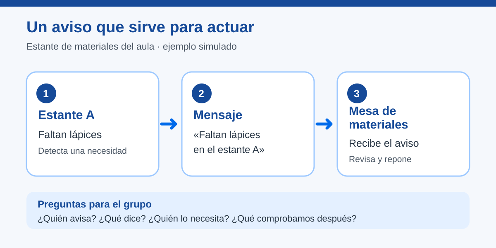
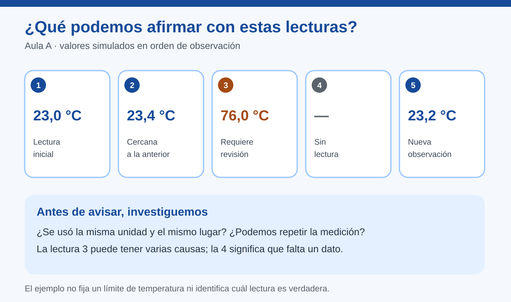

# Mensajes entre objetos y datos confiables: orientación docente

> Este capítulo pertenece a **IoT y Conectividad**. La ruta de la carpeta conserva su nombre anterior para mantener los enlaces existentes del repositorio.

**Estado:** En revisión · **Versión:** v3.0 · **Actualización:** 2026-10-14

## La pregunta del capítulo

**¿Cómo comprobamos lo que observa un objeto y compartimos esa información de manera comprensible?**

En Maker Academy, la pregunta puede explorarse con personas y tarjetas, lecturas simuladas, un prototipo local o dos dispositivos conectados. El capítulo une dos decisiones: **qué sabemos realmente sobre un estado o una medición** y **cómo comunicamos eso a quien lo necesita**. Una entrega exitosa no corrige una lectura equivocada; una lectura bien comprobada tampoco ayuda si el mensaje llega a otra persona o se interpreta mal.

Se utilizan dos situaciones complementarias. Un **estante de materiales** avisa cuando faltan lápices: permite estudiar significado, destinatario y entrega. Un **termómetro ficticio del aula** produce varias lecturas, incluida una discrepante y una ausente: permite revisar unidad, lugar, momento y comprobación antes de avisar. Los estados y valores son simulados. Ninguna situación requiere identificar personas.

*Figura 1. El estante permite seguir un aviso. El dibujo representa su sentido, no un circuito ni una red específica.*

## Alcance y relación con el bloque

[Fundamentos de IoT](../01.%20Fundamentos%20de%20IoT/README.md) presenta las partes del sistema y el recorrido general de los datos. [ESP32](../03.%20ESP32/README.md) y [Plataformas](../02.%20Plataformas%20y%20Herramientas/README.md) explican herramientas y conexiones concretas. Este capítulo se detiene en **la calidad de la observación y la comunicación entre dos puntos**: revisar qué significa un dato, redactar un aviso útil, observar su entrega y corregir lo que confunde a quien lo recibe.

No se espera que todo el estudiantado configure redes. El [mapa de progresión](../01.%20Mapa%20de%20Progresi%C3%B3n.md) sitúa IoT principalmente en Innovation Lab; en los niveles anteriores, las señales, secuencias y comparaciones sencillas preparan esa comprensión.

| Recurso | Decisión que trabaja | Evidencia posible |
| --- | --- | --- |
| [Un mensaje con propósito](mensaje-con-proposito.md) | Elegir destinatario, contenido y respuesta esperada. | Tarjeta o propuesta de mensaje que otra persona entiende. |
| [Del emisor al receptor](del-emisor-al-receptor.md) | Seguir el aviso y observar cuándo llega o se desvía. | Recorrido representado o prueba entre dispositivos. |
| [¿Llegó y se entendió?](llego-y-se-entendio.md) | Distinguir aviso recibido, aviso comprendido y situación atendida. | Prueba, ajuste y nueva comprobación. |
| [Datos confiables](datos-confiables.md) | Comparar lecturas, unidades y contexto antes de convertirlas en conclusiones. | Registro de una discrepancia, comprobación propuesta y aviso honesto. |

## De la observación al mensaje

Los cuatro documentos responden a preguntas que pueden aparecer en distinto orden según el proyecto:

1. **Observar:** si hay una medición, revisar variable, unidad, lugar, momento y discrepancias.
2. **Diseñar:** acordar qué significa el dato o la señal y qué necesita saber quien la recibirá.
3. **Compartir:** comprobar si el aviso sale del origen y aparece en el destino correcto.
4. **Interpretar:** comparar lo que se quiso decir con lo que otra persona entendió y con el estado real.

El orden ayuda a diagnosticar una dificultad. Si la mesa recibió «¡Atención!» pero no sabe qué hacer, conviene revisar el **contenido**. Si la tarjeta clara llegó a otra mesa, la dificultad está en la **entrega**. Si se repusieron los lápices y la mesa sigue viendo el aviso antiguo, hay que revisar **cómo se muestra la actualidad**. Si el mensaje llegó bien pero el sensor estaba junto a una lámpara, conviene revisar **la observación**. Cada problema pide una mejora diferente.

| Si el grupo observa... | Conviene consultar... | Decisión que se espera |
| --- | --- | --- |
| La señal admite varias interpretaciones. | [Un mensaje con propósito](mensaje-con-proposito.md). | Acordar palabras, iconos, ubicación y destinatario. |
| El mensaje es claro pero no aparece donde hace falta. | [Del emisor al receptor](del-emisor-al-receptor.md). | Representar o probar el recorrido y sus extremos. |
| El mensaje aparece, pero confunde sobre lo ocurrido. | [¿Llegó y se entendió?](llego-y-se-entendio.md). | Separar recepción, comprensión y solución. |
| El valor es extraño, carece de unidad o quedó antiguo. | [Datos confiables](datos-confiables.md). | Comparar y comprobar antes de comunicar una conclusión. |

## Dos tipos de información, la misma responsabilidad

Un botón que representa «faltan lápices» comunica un **estado elegido o constatado por alguien**. Un termómetro comunica una **medición** que puede variar por ubicación, momento o condiciones. Ambos necesitan contexto y una persona capaz de interpretarlos, pero la medición añade preguntas sobre unidad, repetición y pertinencia para el lugar.

| Caso | Dato de origen | Comprobación pertinente antes del aviso |
| --- | --- | --- |
| Estante A | Estado «faltan lápices». | Revisar el estante; no inferir quién usó el material. |
| Aula A | «23,0 °C», luego «76,0 °C» en datos simulados. | Revisar unidad y ubicación; repetir o contrastar la lectura diferente. |

La [ilustración de lecturas](imagenes/lecturas-para-investigar.svg) permite mostrar una observación dudosa y un dato ausente sin decidir de antemano cuál es la causa. En ambos casos el mensaje puede decir «necesita verificación» cuando eso es lo que se sabe.

*Figura 2. Los números son ficticios; una diferencia plantea una investigación, no una conclusión automática.*

## Profundizar sin acelerar el currículo

En los primeros niveles, la riqueza está en el **significado**: dos niños pueden discrepar sobre lo que indica un símbolo y modificarlo para entenderse. En primaria superior, se pueden comparar estados o lecturas preparadas con unidad y observar si otra persona interpreta la señal sin ayuda. En secundaria, una entrega preparada permite distinguir lo que muestra el origen de lo que recibe el destino y contrastar una lectura discrepante. Innovation Lab puede decidir si necesita una conexión real, cómo mostrar un aviso anterior o dudoso y qué evidencia obtendrá de usuarios.

Este avance no se mide por la cantidad de dispositivos. Un equipo que justifica por qué un mensaje necesita un destinatario claro ha tomado una decisión de diseño; otro que observa una pantalla encendida sin saber qué confirma necesita volver a la interpretación. Consulte el [mapa de progresión](../01.%20Mapa%20de%20Progresi%C3%B3n.md) para seleccionar autonomía, apoyos y evidencias.

Las tecnologías concretas se trabajan en [ESP32](../03.%20ESP32/README.md) y [Plataformas](../02.%20Plataformas%20y%20Herramientas/README.md). La [práctica guiada de un aviso](../05.%20Pr%C3%A1cticas%20Guiadas/un-aviso-que-si-llega/README.md) desarrolla la parte de comunicación mediante tarjetas; la indagación sobre lecturas se presenta en [Datos confiables](datos-confiables.md). Este capítulo ofrece la base conceptual para adaptar ambas preguntas al grupo.

## Un propósito, cinco niveles

La misma necesidad puede tener expresiones diferentes. La tabla es una guía para seleccionar el alcance, no una lista de requisitos para cada grado.

| Nivel Maker Academy | Qué hace el grupo con el aviso | Qué puede observar la persona docente |
| --- | --- | --- |
| **Exploradores Maker · preescolar** | Una persona hace de estante, otra lleva una tarjeta con un dibujo y otra recibe el aviso. | Reconoce quién necesita saber que faltan lápices y comunica la señal con apoyo. |
| **Inventores Maker · 1.º–3.º** | Ordena tarjetas «ocurre → se avisa → se recibe → se responde» y cambia una que resulte confusa. | Explica a quién va el mensaje y qué pasa si se entrega a otra mesa. |
| **Creadores Maker · 4.º–6.º** | Usa un botón o estado simulado para activar una señal local; registra «hay» y «faltan» con texto o iconos. | Relaciona cada estado con un mensaje y prueba si otra persona lo interpreta igual. |
| **Diseñadores Maker · 7.º–9.º** | Prueba el aviso entre dos equipos o con una interfaz preparada; interrumpe una entrega de forma controlada. | Diferencia un cambio en el estante de lo que muestra el receptor y registra una corrección. |
| **Innovation Lab · 10.º–11.º** | Diseña el intercambio según la necesidad, prueba retrasos o mensajes repetidos y valida la claridad con usuarios. | Justifica qué confirma el sistema, cómo informa la ausencia de actualización y qué mejoró tras la prueba. |

En preescolar y primaria inicial se trabaja una **representación de comunicación**, no un proyecto IoT completo. En primaria superior se puede construir una señal local. La conexión real aparece cuando aporta algo al proyecto y el grupo puede explicar lo que ocurre.

## Aplicación en Maker Academy

### Inspiración

Muestre dos tarjetas: «¡Ayuda!» y «Faltan lápices en el estante A». Pregunte cuál permitiría reponer materiales. Después presente «23,0 °C» y «76,0 °C» como lecturas simuladas del aula: ¿qué habría que comprobar antes de enviar una alerta? Las dos preguntas nacen de una necesidad comprensible.

### Experimentación

Permita que los pares intercambien los papeles de emisor, mensajero, receptor y persona usuaria. Cambie una condición por vez: destino equivocado, tarjeta sin dibujo, aviso retrasado. El juego hace visible el problema; una nueva versión del mensaje permite probar la solución. Con las lecturas simuladas, el equipo puede mantener el valor extraño, anotar una hipótesis y proponer una nueva observación. En niveles mayores puede usar una interfaz o dispositivos preparados y registrar lo observado.

### Reflexión y evaluación formativa

Pida tres respuestas: **¿qué queríamos comunicar?, ¿qué entendió quien recibió el aviso?, ¿qué cambiamos después de probarlo?** Acepte explicación oral, secuencia visual, registro de prueba o documentación técnica según el nivel. Observe si el grupo evita presentar un dato anterior o dudoso como si fuera una medición actual ya comprobada.

## Cuidado de la experiencia

Use estados ficticios y recursos de baja tensión preparados por la persona docente. No asocie el aviso con nombres, fotografías ni hábitos de estudiantes. Cuando una pantalla deje de actualizarse, muestre «sin actualización» en vez de inventar un estado. Las tarjetas y las interfaces deben usar palabras o símbolos además del color; la persona que recibe el mensaje necesita poder interpretarlo.

## Recursos relacionados

- [Mapa de progresión de IoT y Conectividad](../01.%20Mapa%20de%20Progresi%C3%B3n.md).
- [Fundamentos de IoT](../01.%20Fundamentos%20de%20IoT/README.md).
- [ESP32: Wi-Fi básico](../03.%20ESP32/wifi-basico.md), para una ampliación técnica en niveles pertinentes.
- [Prácticas guiadas](../05.%20Pr%C3%A1cticas%20Guiadas/README.md), para planificaciones y montajes.

Las cuatro ilustraciones SVG de esta carpeta son elaboración propia para Maker Academy. Pueden proyectarse, ampliarse o imprimirse; su texto alternativo describe la idea que debe poder comprenderse sin la imagen.
