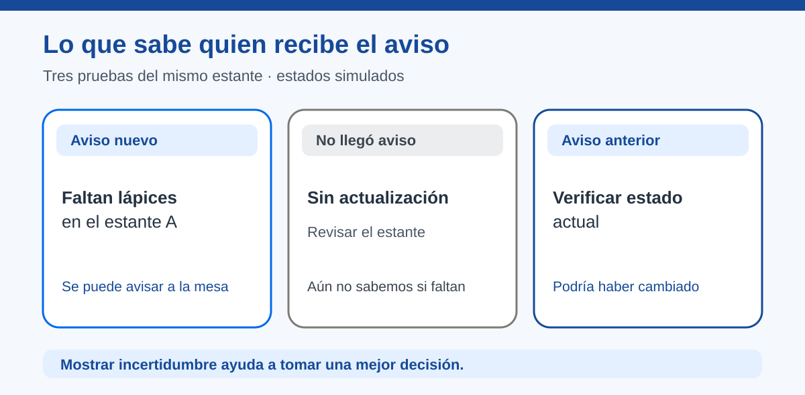

# ¿Llegó y se entendió?

> Recurso de consulta docente · [Volver al capítulo](README.md)

**Estado:** En revisión · **Versión:** v3.0 · **Actualización:** 2026-10-14

## Descripción

Este recurso orienta la interpretación de avisos recibidos, ausentes, ambiguos o antiguos. Ayuda a comunicar con honestidad lo que se conoce y a comprobar si la persona usuaria puede actuar.

## Propósito

Acompañar pruebas de comprensión y actualidad del mensaje, separar recepción de solución y utilizar la interpretación de otras personas para mejorar una interfaz o señal.

## Contenido

### Lo que muestra el receptor

La pantalla de la mesa dice «Faltan lápices en el estante A». El equipo puede comprobar que el aviso apareció. Todavía tiene que comprobar si quien lo vio lo entendió y si luego se repusieron los lápices.

Use tres preguntas: **¿apareció el aviso?, ¿qué entendió quien lo vio?, ¿qué ocurrió luego en el estante?** En niveles iniciales se responden con dibujos y representación; en secundaria, con pruebas y registro.

| Lo observado | Qué conviene mostrar | Por qué |
| --- | --- | --- |
| Llega un aviso nuevo y claro. | «Faltan lápices en el estante A». | La mesa conoce una necesidad concreta. |
| No llega un aviso nuevo. | «Sin actualización; revisar el estante». | Desconocer el estado no significa «hay lápices». |
| Llega un aviso anterior tras reponer. | «Verificar estado actual». | El último aviso recibido puede estar desactualizado. |
| Dice «faltan materiales». | Pedir cuáles y dónde. | Recibir un mensaje no resuelve su ambigüedad. |

*Figura 3. El estado visible se acompaña de palabras; la ausencia de mensajes no confirma que todo esté bien.*

En preescolar, retire o demore una tarjeta. En niveles que usan dispositivos, prepare un cambio de estado e interrumpa temporalmente la comunicación en una demostración controlada. El equipo debe explicar qué sabe y qué necesita comprobar.

### Cuatro preguntas, cuatro evidencias

«Funcionó» puede significar cosas distintas. Para que la explicación del grupo sea precisa, relacione cada afirmación con una observación:

| Pregunta | Evidencia que sí ayuda | Lo que aún no permite afirmar |
| --- | --- | --- |
| ¿Se produjo el aviso? | La tarjeta se creó o el origen cambió de estado. | Que alguien más lo haya recibido. |
| ¿Llegó? | La tarjeta o pantalla del destinatario muestra el aviso. | Que su significado sea claro. |
| ¿Se entendió? | Otra persona explica qué falta y dónde sin pistas. | Que haya actuado. |
| ¿Se resolvió? | Se revisa el estante y se observa el nuevo estado. | Que futuros avisos funcionarán igual. |

En niveles iniciales, las evidencias pueden ser una tarjeta, una explicación y una observación. En los superiores, pueden complementarse con bitácora o registros del prototipo. No hace falta traducir cada fila a una función de software: primero es una forma de razonar sobre lo que sabemos.

### Lo actual y lo anterior

Una tarjeta puesta ayer y una colocada hace un momento pueden tener las mismas palabras. Si la situación cambió, su utilidad es distinta. En una representación se puede colocar una marca «antes / ahora» o sustituir físicamente la tarjeta. En una pantalla, conviene indicar cuándo fue la última actualización **si el equipo puede obtener esa información de manera fiable**.

Compare estas escenas:

- **El estante vuelve a tener lápices y la mesa conserva el aviso anterior.** Hay que revisar antes de volver a reponer.
- **La mesa pierde la señal mientras el estante cambia.** El último valor visible podría seguir mostrándose, pero debe advertirse que no se actualizó.
- **Dos copias del mismo aviso llegan juntas.** El grupo debe comprobar si representan una necesidad o dos; contar tarjetas no equivale a contar faltantes.

La persona docente no necesita introducir relojes, identificadores ni programación de red en preescolar. Las escenas son suficientes para discutir qué se puede afirmar. Con estudiantes mayores, sirven para justificar una mejora de la interfaz o de la documentación.

### Respuesta de la persona usuaria

No siempre se necesita que el receptor confirme la lectura. Si se agrega una respuesta, hay que definir **qué confirma**. «Recibí la tarjeta» indica llegada; «entendí que faltan lápices» muestra interpretación; «revisé el estante» señala una acción; «ya hay lápices» requiere observar el estado. Es útil escribir esas frases por separado antes de diseñar botones de confirmación.

Una pantalla que diga «completado» apenas alguien pulsa «lo vi» mezcla dos hechos. Ese error puede ser más importante que una falla de conexión porque crea una impresión falsa de solución. En el aula, se puede descubrir cuando un equipo toma el papel de usuario y otro observa el estante.

### Criterios para mejorar el mensaje

Después de una prueba, no cambie todo a la vez. Elija la causa que explica la confusión:

| Observación de otro equipo | Cambio razonable | Nueva comprobación |
| --- | --- | --- |
| No sabe a cuál estante ir. | Agregar «estante A» al texto o dibujo. | ¿Encuentra el lugar correcto? |
| No distingue lápices de otros materiales. | Mostrar la palabra o un icono de lápiz reconocible. | ¿Nombra el material sin ayuda? |
| Cree que el aviso sigue vigente. | Indicar «sin actualización» o el momento del último aviso. | ¿Reconoce que debe verificar? |
| Da por terminado el problema al recibirlo. | Cambiar «resuelto» por «aviso recibido» hasta comprobar el estante. | ¿Separa recepción de solución? |

El aprendizaje no está en acumular señales, sino en que cada versión permita una interpretación más acertada para una persona real.

### Probar con otras personas

Invite a alguien que no diseñó el aviso a mirar la tarjeta o pantalla y decir qué ocurrió, dónde, si cree que es actual y qué haría. Si su interpretación difiere de la intención, el equipo cambia el mensaje o la forma de mostrarlo y vuelve a probar. Registre la versión, la interpretación y el cambio, sin nombres de participantes.

En Innovation Lab se puede agregar la hora del último aviso o una confirmación de lectura. **«Lo vi» no equivale a «ya repuse los lápices».** Las acciones físicas requieren su propia comprobación.

### Comunicar lo que todavía no se sabe

Cuando un aviso no se actualiza, la interfaz no siempre conoce el motivo. «Sin actualización» es una descripción honesta de lo observado. «La red falló» solo corresponde si se ha comprobado la causa. Esta diferencia evita que una persona tome una decisión basándose en una explicación inventada.

Puede ser útil distinguir tres situaciones con palabras diferentes:

| Situación | Mensaje posible | Siguiente acción |
| --- | --- | --- |
| No hay información nueva. | «Sin actualización». | Revisar la fuente antes de concluir. |
| El aviso llegó, pero falta un dato esencial. | «Aviso incompleto: verificar lugar». | Pedir o corregir la ubicación. |
| El estante fue revisado. | «Revisión realizada»; actualizar el estado observado. | Confirmar si ya hay lápices. |

Con niños pequeños, estos casos pueden mostrarse con una tarjeta vacía, otra incompleta y una tarjeta nueva. En colegio, pueden orientar estados distintos en una interfaz. La información sobre **cuándo se actualizó** debe proceder de una observación o registro real; escribir una hora decorativa puede dar una falsa sensación de actualidad.

### Comprender una lectura dudosa

Si el receptor ve «76,0 °C · aula A» y explica correctamente esas palabras, hay evidencia de comprensión del mensaje, pero falta evidencia de que la medición represente la temperatura del aula. El equipo puede comparar la lectura con otras, revisar la unidad y el lugar, y mostrar «lectura inusual; verificar» mientras investiga. Una pantalla que solo presenta el valor, sin indicar que se está comprobando, puede llevar a una decisión equivocada aun cuando la entrega haya funcionado. Use el caso y las preguntas de [Datos confiables](datos-confiables.md) para probar qué entiende otra persona de una lectura marcada como dudosa.

### Preguntas para una reflexión más profunda

- Si la pantalla muestra el último aviso, ¿cómo sabrá la persona usuaria que puede ser anterior?
- Si dos personas interpretan de manera distinta la misma tarjeta, ¿qué parte del mensaje necesita cambiar?
- Si alguien pulsa «recibido», ¿qué hecho confirma ese botón?
- Si el estante ya está lleno, ¿qué observación permite retirar o actualizar el aviso?
- ¿Qué información sería innecesaria o invasiva para resolver este problema?

La respuesta no tiene que incluir vocabulario técnico. Debe apoyarse en lo que el grupo efectivamente probó y en una decisión de mejora.

## Aplicación en Maker Academy

- **Inspiración:** muestre un aviso cuando el estante ya fue repuesto. Pregunte si todavía ayuda.
- **Experimentación:** compare entrega normal, ausencia y retraso; cambie el mensaje o la pantalla.
- **Reflexión:** documente una interpretación ajena, una mejora y el resultado de volver a probar.

**Evidencia:** el equipo distingue observación de suposición y comunica la falta de actualización sin inventar un estado.

## Recursos relacionados

- [Orientación del capítulo](README.md).
- [Del emisor al receptor](del-emisor-al-receptor.md).
- [Datos confiables: ¿podemos creerle al sensor?](datos-confiables.md).
- [Mapa de progresión](../01.%20Mapa%20de%20Progresi%C3%B3n.md).
- [Práctica Un aviso que sí llega](../05.%20Pr%C3%A1cticas%20Guiadas/un-aviso-que-si-llega/README.md).

## Nota docente

Evite utilizar «funciona» como única conclusión. Pida al equipo que nombre la observación que la respalda y lo que todavía no ha comprobado.
