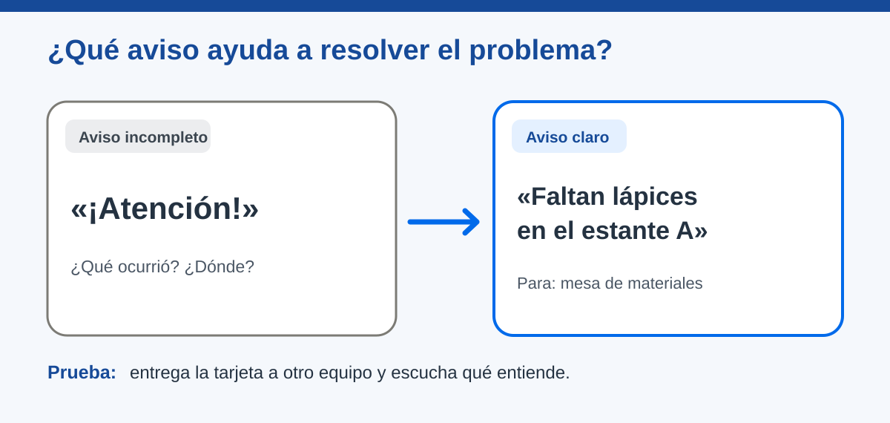

# Un mensaje con propósito

> Recurso de consulta docente · [Volver al capítulo](README.md)

**Estado:** En revisión · **Versión:** v2.0 · **Actualización:** 2026-10-14

## La situación

En el estante A quedan pocos lápices. Una tarjeta que solo dice «¡Atención!» llega a la mesa de materiales. El aviso llegó, pero nadie sabe qué reponer ni dónde. El problema se puede descubrir antes de utilizar sensores o una red.

Pregunte: **«Si tuvieras que actuar con solo esta tarjeta, ¿qué podrías hacer?»**. Las respuestas muestran qué información falta.

| Pregunta | Decisión en este caso | Cómo comprobarla |
| --- | --- | --- |
| ¿Quién avisa? | Estante A. | ¿Hay otro estante con el que se pueda confundir? |
| ¿Qué ocurre? | Faltan lápices. | ¿Queda claro qué material hace falta? |
| ¿A quién va? | Mesa que repone materiales. | ¿Se sabe quién recibirá el aviso? |
| ¿Para qué? | Revisar y reponer. | ¿Puede la persona receptora decidir qué hacer? |

«Faltan lápices en el estante A», dirigido a la mesa de materiales, es suficiente para esta situación. El aviso todavía no demuestra que los lápices fueron repuestos.

*Figura 2. La ubicación y el contenido permiten usar el aviso sin registrar datos personales.*

## De la señal al mensaje

En preescolar, un dibujo de lápices con una señal de «faltan» puede bastar si el grupo acuerda su significado. En primaria, añada una palabra y el lugar. En secundaria, compare estados como «hay lápices» y «faltan lápices» y decida qué verá el receptor cuando no haya información nueva.

Una prueba sencilla consiste en dar la tarjeta a otro equipo **sin explicación oral previa**. Si interpreta otra cosa, el grupo revisa el texto, el icono o el destinatario. El color por sí solo puede confundir; use también palabras o símbolos. En niveles superiores se puede añadir el momento del aviso si la prueba muestra que hace falta distinguir uno actual de uno anterior.

## Aplicación en Maker Academy

- **Inspiración:** presente «¡Atención!» y «Faltan lápices en el estante A». Pida elegir cuál permite actuar y por qué.
- **Experimentación:** un equipo dibuja o redacta un aviso; otro lo interpreta y dice qué haría.
- **Reflexión:** compare intención e interpretación. Conserve ambas versiones y el motivo del cambio en la Documentación maker.

**Evidencia:** el grupo identifica destinatario y propósito, crea un mensaje comprensible y lo ajusta tras recibir comentarios.

Continúe con [Del emisor al receptor](del-emisor-al-receptor.md).
