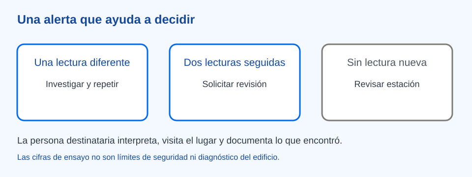

# Una alerta que ayuda a decidir — estación ambiental

> Bloque: **IoT y Conectividad** · [Índice de prácticas](../README.md) · [Datos confiables](../../04.%20Protocolos%20de%20Comunicaci%C3%B3n/datos-confiables.md)

**Estado:** En revisión · **Versión:** v1.0 · **Actualización:** 2026-10-20
**Nivel principal:** Innovation Lab (10.º–11.º); simulación y diagnóstico en Creadores y Diseñadores Maker
**Tiempo orientativo:** 70–90 minutos; 45 minutos con datos preparados

## Reto y aprendizaje esperado

La estación ambiental del makerspace registra cambios de temperatura. El equipo quiere avisar a la persona encargada cuando convenga **revisar el espacio**, sin convertir una sola lectura extraña en una afirmación de peligro y sin anunciar «todo bien» si dejó de medir. Diseñará una regla de aviso, probará situaciones normales y fallidas y pedirá a otra persona que interprete el mensaje.

Las cifras de esta práctica son **datos ficticios para probar lógica**. No son límites de salud, seguridad o confort. La alerta solicita una comprobación humana; el prototipo no diagnostica condiciones del edificio.

## Materiales y decisiones previas

- Tarjetas con la secuencia de abajo, papel para una bitácora y una pantalla dibujada o fichas de estado.
- Opcional para los niveles mayores: estación de baja tensión ya probada, un indicador local y un medio de aviso autorizado. Una conexión remota solo se incorpora si la persona destinataria realmente la necesita. Consulte [ESP32](../../03.%20ESP32/README.md) y [sensor a la nube](../sensor-a-nube/README.md) para preparar las partes técnicas.
- Defina junto al grupo **quién recibe**, qué acción puede realizar, cuánto tiempo hace útil el dato y cómo se cancela o reconoce un aviso. No envíe alertas automáticas a contactos externos durante la prueba; use destinatarios ficticios o un entorno institucional de ensayo.

Para comparar versiones, use esta **regla de ensayo**: dos lecturas válidas consecutivas por encima de `27 °C` activan «Revisar ubicación y ventilación»; una sola lectura mayor no basta. Al bajar de `26 °C`, marque «Observación finalizada» tras confirmar una nueva lectura válida. Entre 26 y 27 °C conserve el estado anterior; esto evita un cambio continuo cerca del límite. Si no hay lectura nueva dentro del intervalo de actualidad acordado para la demostración (por ejemplo, cinco minutos), el estado pasa a **«Sin actualización; revisar estación»**, sin concluir que el ambiente mejoró. Esos números se eligieron para el juego de pruebas, no para la operación real de una instalación.

| Orden | Dato ficticio | Qué pone a prueba |
| --- | --- | --- |
| 1 | 24,0 °C | Estado inicial. |
| 2 | 28,0 °C | Una lectura elevada aislada. |
| 3 | 24,2 °C | Vuelta al valor previo; revisar posible causa del salto. |
| 4 | 27,4 °C | Primer valor por encima del límite de ensayo. |
| 5 | 27,6 °C | Segundo consecutivo; corresponde solicitar revisión. |
| 6 | 26,5 °C | Zona intermedia: conservar estado, no alternar. |
| 7 | Sin lectura nueva | Se pierde la vigencia; avisar que falta información. |
| 8 | 25,5 °C | Tras recuperar lectura válida, comprobar condición de cierre. |

## Inspiración · una alerta puede confundir

Enseñe dos mensajes: «¡Peligro!» y «Makerspace: dos lecturas de ensayo mayores de 27 °C; revisá sensor y ventilación. Última lectura: 10:05». Pregunte: **«¿Cuál ayuda a actuar y cuál afirma más de lo que sabemos?»**. Presente la situación de una persona encargada que no estuvo frente al sensor. El grupo propone qué información y qué forma de confirmación necesita.

## Experimentación · diseñar, simular, revisar

1. Dibuje cuatro estados: **En observación**, **Revisar espacio**, **Sin actualización** y **Observación finalizada**. Escriba junto a cada transición qué lectura o ausencia de lectura la provoca.
2. Reparta los papeles de sensor, responsable de la regla, mensajero y persona destinataria. Pase las ocho tarjetas en orden, sin enseñar la siguiente. Registre dato, estado y mensaje mostrado después de cada una.
3. Para las tarjetas 2 y 3, pregunte si se justifica avisar. Proponga comprobar ubicación y repetir medición; no borre el valor extraño. Para 4 y 5, compare los mensajes antes y después de la confirmación. Para 6, observe si el estado oscila sin razón.
4. En 7, avance el reloj más allá de la vigencia acordada. Muestre «Sin actualización» **aunque el último valor visible fuera alto**; conserve ese valor con su hora y una etiqueta histórica. En 8, confirme la lectura recuperada antes de cerrar el aviso. «Sin actualización» es un estado de información: conserve en la bitácora que había una revisión pendiente hasta que una lectura nueva y la persona encargada permitan resolverla.
5. Entregue la pantalla y el mensaje a otro equipo. Pregunte qué cree que ocurrió, qué haría y qué dato necesitaría para decidir. Modifique una sola parte de la regla o del mensaje y repita al menos las pruebas 2, 5 y 7.

| Prueba clave | Resultado razonable con la regla de ensayo | Error que conviene descubrir |
| --- | --- | --- |
| Una lectura 28,0 °C | Investigar; no declarar un problema confirmado. | Disparar «peligro» sin segunda lectura. |
| Dos lecturas consecutivas > 27 °C | Solicitar revisión e indicar momento y lugar. | Aviso sin destinatario ni acción. |
| 26,5 °C tras el aviso | Mantener el estado y observar siguiente dato. | Alternar aviso/normal por ruido cerca del límite. |
| Ausencia de lectura nueva | «Sin actualización» y petición de comprobar la estación. | Mostrar «normal» o reutilizar el valor antiguo como actual. |
| Lectura válida 25,5 °C | Evaluar cierre y dejar constancia de la revisión humana. | Confundir recepción del mensaje con problema atendido. |

### Ajuste por nivel

| Nivel | Versión alcanzable | Evidencia |
| --- | --- | --- |
| **Exploradores · preescolar** | Una tarjeta «necesitamos mirar» y una persona que la recibe. | Señala a quién avisar con ayuda. |
| **Inventores · 1.º–3.º** | Ordena observación, aviso y visita al lugar. | Distingue aviso entregado de situación resuelta. |
| **Creadores · 4.º–6.º** | Compara lecturas ficticias con unidad y prueba un aviso local. | Explica por qué revisaría una lectura diferente. |
| **Diseñadores · 7.º–9.º** | Simula la regla con tarjetas, bloques o datos preparados; prueba pérdida de dato. | Registra un fallo y ajusta el mensaje. |
| **Innovation Lab · 10.º–11.º** | Implementa una alerta en entorno autorizado, verifica tiempos, acceso y recuperación con usuarios. | Justifica umbrales del caso real con evidencia y límites explícitos. |

Las versiones de preescolar y primaria inicial representan una señal para otra persona; no programan una alerta IoT. En una aplicación real, los límites se establecen con responsables del espacio y fuentes pertinentes, nunca copiando la regla ficticia.

## Reflexión y evaluación formativa

Compare la primera y segunda versión del aviso. Pida la tabla de las ocho decisiones y una explicación de **«¿qué cambió después de la prueba con usuarios?, ¿qué no podemos concluir de una lectura?, ¿cómo sabría la persona destinataria que el sistema dejó de actualizarse?»**. Observe si la respuesta identifica origen, momento, incertidumbre y acción; si la mejora corrige un problema observado; y si nadie supone que el aviso recibido prueba una intervención completada. Una devolución concreta: «El mensaje dice que hay que revisar, pero no dónde. ¿Qué añadirías y con quién lo comprobarías?».

Si la regla dispara demasiados avisos, examine la secuencia y la confirmación antes de cambiar el límite. Si nunca se cierra, compruebe qué dato válido permite la transición y si la persona destinataria confirmó la revisión. Ante red o sensor ausentes, conserve el estado «Sin actualización» y termine con la simulación; no se necesitan cuentas ni mensajes externos para lograr el aprendizaje.

## Para seguir

- [Datos confiables](../../04.%20Protocolos%20de%20Comunicaci%C3%B3n/datos-confiables.md)
- [¿Llegó y se entendió?](../../04.%20Protocolos%20de%20Comunicaci%C3%B3n/llego-y-se-entendio.md)
- [Tablero de temperatura](../dashboard-temperatura/README.md)
- [Mapa de progresión](../../01.%20Mapa%20de%20Progresi%C3%B3n.md)
