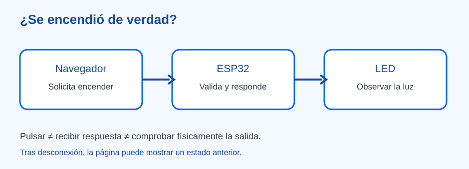

# ¿Se encendió de verdad? — control local de un LED

> Bloque: **IoT y Conectividad** · [Índice de prácticas](../README.md) · [Servidor web embebido](../../03.%20ESP32/servidor-web-embebido.md)

**Estado:** En revisión · **Versión:** v1.0 · **Actualización:** 2026-10-20
**Nivel principal:** Diseñadores Maker (7.º–9.º), con demostración preparada; desarrollo autónomo en Innovation Lab
**Tiempo orientativo:** 70–90 minutos, o dos sesiones si el grupo monta y depura

## Reto y aprendizaje esperado

Desde una página en la red local, una persona solicita encender una luz de señalización de un prototipo. La página responde, pero ¿el LED cambió? El reto es separar **intención, respuesta del servidor y estado físico observado**, y diseñar una forma de apagar la luz aunque nadie vuelva a tocar la página. Se usa un LED de prueba, no iluminación del edificio ni un dispositivo de potencia.

Al finalizar, el equipo explica el trayecto navegador → servidor → salida, registra una acción exitosa y una fallida, y evita afirmar que el LED está encendido solo porque se pulsó un botón.

## Materiales y preparación docente

- Para representar la idea: tarjetas «solicitud», «respuesta» y «LED observado», y dos fichas «encendido» y «apagado».
- Para la ampliación física: ESP32-DevKitC con módulo ESP32-WROOM original, LED externo, resistencia de **330 Ω**, protoboard, cables, USB de datos y un dispositivo de aula autorizado. Consulte el [montaje y programa de referencia](../../03.%20ESP32/servidor-web-embebido.md) antes de impartir la sesión.
- Con alimentación desconectada, conecte **GPIO23 → resistencia de 330 Ω → ánodo del LED; cátodo → GND**. Verifique polaridad, modelo de placa, pinout, alimentación y versión del paquete Arduino-ESP32 3.x. No transfiera el pin a otra variante de ESP32 sin comprobarla.

La referencia del capítulo de ESP32 crea un **punto de acceso local** y usa `GET /` para la página, `GET /estado` para consultar y `POST /led` con `estado=1` o `estado=0` para solicitar un cambio. Incluye autorización de aplicación y apagado por tiempo. La persona docente debe compilarla y probarla en su equipo antes de la clase; no hay credenciales ni red pública compartidas en esta guía. La red local no necesita Internet. Prepare una demostración con tarjetas si la placa o el navegador no están disponibles.

## Inspiración · tres afirmaciones distintas

Muestre la ficha «Pulsé encender». Pregunte: **«¿Qué demuestra este gesto?»**. Luego añada «El servidor aceptó la solicitud» y «Vi el LED encendido». El grupo coloca las tarjetas en orden y discute qué prueba corresponde a cada afirmación. Pregunte quién podrá controlar la señal, cuándo se apagará y qué pasa si se pierde la comunicación.

## Experimentación · una acción y tres comprobaciones

### Representación antes del montaje

En tríos, una persona es navegador, otra servidor y otra observa el LED. El navegador entrega `encender`; el servidor decide si acepta la solicitud y devuelve una respuesta; la tercera persona cambia la ficha física solo cuando corresponde. Repita con una solicitud no autorizada y una entrada diferente de `0` o `1`. Un mensaje «recibido» no sustituye observar la salida.

### Demostración con ESP32 preparado

1. Conecte el cliente al punto de acceso de demostración y abra la dirección que muestra el monitor serie de la placa. La persona docente guarda las credenciales y las cambia antes de cualquier otra sesión.
2. Abra `GET /estado` y anote el estado inicial. Mire el LED. Compare ambos datos.
3. Desde la página, solicite encender. Anote **solicitud**, respuesta y estado observado; vuelva a consultar `/estado`. Espere el apagado automático de la referencia y compruebe otra vez.
4. Solicite apagar. Después pruebe, bajo supervisión, un parámetro distinto de `0` y `1` y un acceso sin autorización. Se espera rechazo sin cambio del LED; la manera concreta de enviar estas solicitudes puede prepararla la persona docente. No exponga la red de demostración a terceros.
5. Corte temporalmente la conexión del cliente, no la alimentación del circuito. Explique por qué una página abierta puede mostrar un estado anterior. Reconecte y haga una consulta nueva; si no puede probarse, anote «estado no confirmado».

| Caso | Solicitud/respuesta esperada | Comprobación adicional |
| --- | --- | --- |
| Consulta inicial | `GET /estado` devuelve el estado lógico. | Compararlo con el LED observado. |
| Encender | `POST /led` con `estado=1` autorizado. | Ver LED, consultar estado y esperar apagado automático. |
| Parámetro inválido | Respuesta de error; el estado se conserva. | Verificar que el LED no cambió. |
| Acceso no autorizado | Rechazo; sin acción. | No inferir un cambio por haber abierto la página. |
| Cliente desconectado | No hay consulta nueva. | Etiquetar el valor de la página como anterior o no confirmado. |

El programa de referencia devuelve **estado lógico** y tiempo desde el arranque. Incluso una respuesta correcta no detecta por sí sola un LED mal conectado o quemado: para confirmar el estado físico se necesita observación o una realimentación independiente.

### Ajuste por nivel

| Nivel | Alcance | Evidencia |
| --- | --- | --- |
| **Exploradores · preescolar** | Juego de roles de pedir y observar una señal. | Relaciona una petición con una respuesta visible. |
| **Inventores · 1.º–3.º** | Secuencia de tarjetas «pedir → aceptar → comprobar». | Cuenta qué falta cuando no se ve la señal. |
| **Creadores · 4.º–6.º** | Botón y LED locales con montaje preparado, sin interfaz web obligatoria. | Prueba encendido y apagado. |
| **Diseñadores · 7.º–9.º** | Navegador y ESP32 local ya preparados; compara `/estado` y LED. | Registra un éxito y un rechazo. |
| **Innovation Lab · 10.º–11.º** | Adapta control, autorización y tiempo de apagado a usuarios reales. | Justifica acceso, recuperación y evidencia física de funcionamiento. |

Los primeros niveles representan la lógica o prueban un circuito local; no requieren configurar un servidor.

## Reflexión, evidencia y mejora

Cada equipo entrega una tabla con dos recorridos, su observación del LED y una decisión de mejora. Pregunte **«¿En qué momento supimos que el servidor respondió? ¿En cuál comprobamos la luz? ¿Qué mostraríamos tras perder conexión?»**. Una propuesta razonable es añadir «última consulta» a la interfaz. Valore la correspondencia entre petición y resultado, la detección de una entrada inválida y la explicación del apagado automático, no la cantidad de líneas de código.

Si el LED no enciende, desconecte la alimentación y revise polaridad, resistencia, pin y tierra común. Si la página no abre, compruebe primero que el cliente está en la red local correcta y que usa la dirección de la placa. Si la interfaz se queda «encendida» tras el apagado, haga una consulta nueva y distinga la página anterior del estado actual. Use baja tensión; nunca conecte cargas de red eléctrica a esta práctica.

## Para seguir

- [Servidor web embebido: contrato de rutas y programa](../../03.%20ESP32/servidor-web-embebido.md)
- [Wi-Fi básico y diagnóstico](../../03.%20ESP32/wifi-basico.md)
- [Un aviso que sí llega](../un-aviso-que-si-llega/README.md)
- [Mapa de progresión](../../01.%20Mapa%20de%20Progresi%C3%B3n.md)
