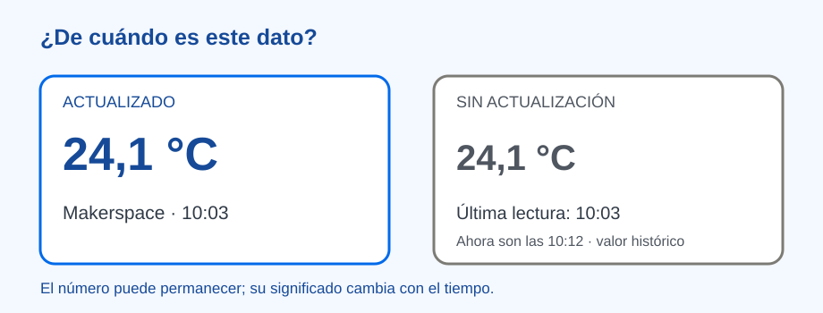

# ¿De cuándo es este dato? — tablero de temperatura

> Bloque: **IoT y Conectividad** · [Índice de prácticas](../README.md) · [Datos confiables](../../04.%20Protocolos%20de%20Comunicaci%C3%B3n/datos-confiables.md)

**Estado:** En revisión · **Versión:** v1.0 · **Actualización:** 2026-10-20
**Nivel principal:** Creadores Maker (4.º–6.º); ampliación en Diseñadores Maker e Innovation Lab
**Tiempo orientativo:** 50–70 minutos; 30 minutos con tarjetas preparadas

## Reto y aprendizaje esperado

La estación ambiental del makerspace muestra `24,1`. Quien entra no sabe si se trata de temperatura, si corresponde a este lugar o si se midió hace una hora. El equipo diseñará un tablero que permita **leer una observación y saber cuándo deja de ser actual**. Al terminar, otra persona debe poder explicar valor, unidad, lugar, momento y estado de actualización; el grupo debe distinguir una lectura de una conclusión sobre el aula.

*Las cifras son ficticias; el dibujo no establece un límite térmico para el aula.*

## Materiales y preparación docente

- Cuatro tarjetas con las lecturas de abajo, papel, lápices y un reloj visible. La tabla puede proyectarse si no se imprime.
- Opcional: termómetro y pantalla preparados por la persona docente. Las mediciones reales deben etiquetarse como tales y no asociarse con personas.
- Para grupos mayores, una interfaz local o un servicio autorizado. [ThingSpeak](../../02.%20Plataformas%20y%20Herramientas/thingspeak.md) ofrece la referencia de series de datos; no se necesita una cuenta para esta práctica.

Fije una regla de actualidad **solo para esta simulación**: si pasan más de cinco minutos sin una nueva lectura válida, mostrar «Sin actualización». Conserve el valor anterior únicamente como histórico y con su hora. El intervalo real dependería de la necesidad y de la frecuencia de medición.

| Registro ficticio | Lugar | Hora | Temperatura | Pregunta |
| --- | --- | --- | --- | --- |
| A | Makerspace | 10:00 | 23,8 °C | ¿Qué se midió? |
| B | Makerspace | 10:03 | 24,1 °C | ¿Qué cambió desde A? |
| C | Makerspace | 10:04 | 76,0 °C | ¿Qué comprobar antes de interpretarlo? |
| D | Makerspace | 10:12 | Sin lectura | ¿Qué sabemos sobre el estado actual? |

## Inspiración · ¿qué entiende quien ve la pantalla?

Muestre solo `24,1` y pregunte a otra pareja qué podría hacer con ese número. Añada `°C`, `Makerspace` y `10:03` de uno en uno. Finalmente, indique que el reloj marca 10:12. Pregunte **«¿Qué parte de la pantalla debe cambiar aunque el número no cambie?»**. La persona usuaria necesita saber si puede tomar una decisión *ahora* o si debe revisar la estación.

## Experimentación · construir, probar y corregir

Cada equipo dibuja cuatro zonas: **valor y unidad**, **lugar**, **hora de la última lectura válida** y **estado** («Actualizado», «Por comprobar» o «Sin actualización»). Una persona hace de estación, otra actualiza el tablero y otra entra como visitante. Rote los papeles antes de repetir la prueba.

1. Entregue A y B en orden. Quien visita el tablero dice qué se midió y cuándo, sin recibir explicaciones del equipo creador.
2. Entregue C. Registre el valor original y márquelo «Por comprobar». Proponga una repetición en el mismo lugar, una revisión de la unidad o una comparación con otro instrumento. La tabla no demuestra por sí sola que C sea erróneo.
3. Avance el reloj a 10:12 y entregue D. Muestre «Sin actualización · última lectura válida: 10:03»; si se conserva `24,1 °C`, márquelo como **histórico**. «Sin lectura» no significa `0 °C`.
4. Tape la unidad de una tarjeta. Pregunte qué información falta para comparar. Después haga que otro equipo pruebe el tablero y anote una confusión concreta. Cambie una etiqueta, ubicación o tamaño de texto y repita la prueba.

| Prueba | Lo que se espera observar | Evidencia |
| --- | --- | --- |
| B llega normalmente | `24,1 °C · Makerspace · 10:03 · Actualizado`. | El visitante identifica dato, lugar y hora. |
| C es diferente | Se conserva y se pide comprobar; no se inventa una causa. | Una pregunta o nueva medición propuesta. |
| D no contiene lectura | Aparece «Sin actualización» y el valor anterior queda rotulado como histórico. | El visitante deja de tratarlo como dato actual. |
| Falta `°C` | Se señala la unidad ausente. | Nadie adivina qué representa el número. |

### Ajuste por nivel

| Nivel | Versión alcanzable | Qué comprobar |
| --- | --- | --- |
| **Exploradores · preescolar** | Dibujos de «hay una observación» y «hay que mirar de nuevo», sin números. | Señala cuándo falta información. |
| **Inventores · 1.º–3.º** | Ordena tarjetas de antes y ahora. | Distingue un aviso anterior de uno nuevo. |
| **Creadores · 4.º–6.º** | Tablero de papel con unidad y hora; cuatro pruebas. | Corrige una confusión escuchando al visitante. |
| **Diseñadores · 7.º–9.º** | Panel digital con datos simulados o sensor local preparado. | Separa pérdida de lectura de último valor guardado. |
| **Innovation Lab · 10.º–11.º** | Fuente conectada si responde a una necesidad; intervalo justificado y prueba con usuarios. | Explica vigencia, discrepancias y límites de la conclusión. |

Los dos primeros niveles trabajan antecedentes de secuencia y comunicación; no tienen como objetivo construir un tablero IoT.

## Reflexión y evaluación formativa

Compare la primera pantalla con la corregida: **«¿Qué entendió otra persona que ustedes no querían decir? ¿Qué cambió? ¿Qué no pueden afirmar sobre el aula?»**. Puede recogerse una explicación oral, el dibujo marcado y un registro de las cuatro pruebas. Observe si la mejora responde a la confusión, si la unidad y la hora se leen y si C y D no se disfrazan de datos actuales. Una devolución útil sería: «Veo 24,1 °C, pero no sé si llegó hace un minuto o hace nueve. ¿Dónde pondrían la hora?».

Si todas las tarjetas parecen iguales, simule el salto del reloj. Si el equipo llama «error» a todo valor diferente, pida una prueba que permita investigarlo. Sin red, las tarjetas completan la experiencia. Con hardware, use baja tensión y equipo probado; no publique nombres ni hábitos de estudiantes.

## Para seguir

- [Datos confiables: ¿podemos creerle al sensor?](../../04.%20Protocolos%20de%20Comunicaci%C3%B3n/datos-confiables.md)
- [Sensor a la nube](../sensor-a-nube/README.md), cuando conservar la serie fuera del dispositivo aporte valor.
- [Mapa de progresión](../../01.%20Mapa%20de%20Progresi%C3%B3n.md)
