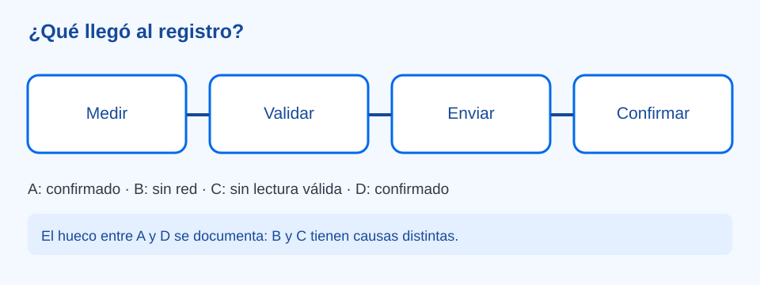

# Del sensor al registro remoto — ¿qué llegó realmente?

> Bloque: **IoT y Conectividad** · [Índice de prácticas](../README.md) · [ThingSpeak](../../02.%20Plataformas%20y%20Herramientas/thingspeak.md)

**Estado:** En revisión · **Versión:** v1.0 · **Actualización:** 2026-10-20
**Nivel principal:** Innovation Lab (10.º–11.º); análisis guiado en Diseñadores Maker
**Tiempo orientativo:** dos sesiones de 60–80 minutos; una sesión con datos preparados

## Reto y aprendizaje esperado

Un equipo necesita comparar la temperatura del makerspace a lo largo de la jornada, incluso cuando no está frente al dispositivo. La tarea es obtener una lectura con contexto, decidir si sirve, **enviarla a un registro remoto autorizado y comprobar que quedó registrada**. Mostrar «enviando» en una pantalla no demuestra que el servicio recibió el dato. Una gráfica tampoco demuestra que cada punto sea correcto.

Al terminar, el grupo podrá seguir una lectura desde el origen hasta el canal, distinguir intento de envío de confirmación y explicar un hueco en la serie sin rellenarlo silenciosamente.

## Preparación y materiales

- Para toda la experiencia: tarjetas con la serie ficticia siguiente, una tabla o bitácora, reloj y papel para representar «dispositivo», «red» y «registro remoto».
- Solo para la ampliación técnica: ESP32 y sensor compatible **ya probados en el centro**, entorno instalado, red con acceso autorizado y un canal de ThingSpeak gestionado por la persona docente. Consulte [ESP32](../../03.%20ESP32/README.md), [Wi-Fi básico](../../03.%20ESP32/wifi-basico.md) y la [referencia de ThingSpeak](../../02.%20Plataformas%20y%20Herramientas/thingspeak.md) para el montaje, validación y API. No se presupone un modelo de sensor ni pinout universal.
- Prepare un canal privado de demostración con **campo 1: temperatura (°C)**. Guarde la Write API Key fuera del repositorio y de capturas; use Read API Key solo donde corresponda. Compruebe los límites y el intervalo permitido por la cuenta antes de la sesión. Los tiempos de abajo son ficticios y no ordenan publicar cada minuto en el servicio.

| Lectura de ensayo | Hora simulada | Dato | Resultado de envío simulado |
| --- | --- | --- | --- |
| A | 09:00 | 23,8 °C | Confirmado; registro 101. |
| B | 09:05 | 24,1 °C | Sin conexión; no confirmado. |
| C | 09:10 | Sin lectura válida | No se envía. |
| D | 09:15 | 24,3 °C | Confirmado; registro 102. |

El equipo decide si B se conserva localmente con su hora de medición para intentar recuperarlo; no debe convertirlo en «lectura tomada a las 09:15». La hora de medición y la de recepción pueden ser distintas. Tampoco debe dibujar C como `0 °C`.

## Inspiración · un gráfico con un hueco

Muestre los registros remotos 101 y 102 sin contar lo ocurrido entre ambos. Pregunte **«¿Podemos asegurar que el makerspace estuvo a la misma temperatura durante esos quince minutos?»**. Entregue después la tabla completa. Los equipos ubican las cuatro tarjetas en el recorrido y señalan cuál se midió, cuál se intentó enviar y cuál recibió confirmación. Pregunte para quién sería útil recuperar B y si el registro necesita indicar que llegó tarde.

## Experimentación · seguir el dato y probar el fallo

### Ensayo con tarjetas, obligatorio antes de conectar

1. El equipo acuerda un contrato de dato: `temperatura_c` numérica, unidad °C, origen «makerspace» y momento de medición. Escriba qué hará ante una lectura ausente, un formato inválido o un valor discrepante.
2. Una persona representa el sensor, otra valida, otra es la red y otra el servicio. Entregue A: el servicio asigna el registro 101 y confirma la recepción. La bitácora separa `medido`, `enviado` y `confirmado`.
3. Entregue B, pero la red retiene el mensaje. El grupo anota «pendiente / sin confirmación»; el servicio no debe mostrarlo como recibido. Entregue C y decida que no hay valor válido que publicar. Entregue D y permita confirmación 102.
4. Compare la serie del dispositivo con la del servicio. Proponga una nueva versión: conservar B localmente con su hora y enviarlo después **solo si la plataforma y el diseño admiten registrar correctamente ese momento**; de lo contrario, documentar el hueco. No duplique B como si fuera una lectura nueva.

| Prueba | En el dispositivo | En el servicio | Pregunta de diagnóstico |
| --- | --- | --- | --- |
| A confirmada | Lectura válida y respuesta positiva. | Entrada 101. | ¿Coinciden campo, unidad y orden? |
| B sin red | Lectura válida, envío sin confirmar. | No hay entrada B. | ¿Dónde se interrumpió el trayecto? |
| C inválida | «Sin lectura válida». | No se publica `0`. | ¿Qué revisar del sensor? |
| D confirmada | Lectura válida y respuesta positiva. | Entrada 102. | ¿Qué hueco sigue sin explicación en el gráfico? |

### Ampliación con servicio autorizado

Con el montaje previamente probado, publique **una lectura válida de ensayo** respetando la frecuencia permitida. Registre el valor local y la respuesta de la API; lea después el campo del canal privado y compruebe valor, unidad definida para ese campo y fecha de la entrada. Una respuesta HTTP favorable sin identificador de entrada válido requiere revisión conforme a la [guía de ThingSpeak](../../02.%20Plataformas%20y%20Herramientas/thingspeak.md). Simule luego la pérdida de red desconectando el acceso del dispositivo de prueba, sin manipular el sensor con alimentación conectada. Muestre el intento fallido y el hueco en la vista remota. La demostración puede hacerse con datos ficticios si el hardware no está disponible.

La conexión del dispositivo a un servicio externo exige autorización institucional, cuidado con credenciales y datos no personales. Un canal privado sigue necesitando una política de acceso y de conservación; no incluya la clave en una URL compartida, captura o commit.

### Ajuste por nivel

| Nivel | Punto de entrada | Evidencia |
| --- | --- | --- |
| **Exploradores · preescolar** | Representa llevar una tarjeta a otra mesa. | Distingue salida y llegada con apoyo. |
| **Inventores · 1.º–3.º** | Ordena entrega y recepción. | Señala una tarjeta que nunca llegó. |
| **Creadores · 4.º–6.º** | Compara una tabla local y otra remota ficticia. | Señala el dato ausente sin inventarlo. |
| **Diseñadores · 7.º–9.º** | Sigue un envío preparado y diagnostica un corte. | Distingue dispositivo, red y servicio. |
| **Innovation Lab · 10.º–11.º** | Configura el flujo autorizado, valida respuestas y diseña recuperación. | Justifica frecuencia, metadatos, acceso y manejo de retrasos. |

Los primeros niveles exploran antecedentes; no crean cuentas ni configuran una nube.

## Reflexión y evaluación formativa

Pida una tabla que enfrente los cuatro registros locales con las entradas remotas y una explicación de por qué faltan B y C. Pregunte: **«¿Qué evidencia nos permite decir que A llegó? ¿En qué momento se midió B? ¿Qué decisión cambiaríamos después de ver el hueco?»**. Una mejora concreta puede ser distinguir «última lectura local» de «última confirmada» en la interfaz. Observe si el equipo reconoce la diferencia entre valor inválido y fallo de red, y si conserva hora y unidad en la explicación.

Si la publicación falla, revise en orden lectura local, conexión, respuesta HTTP, identificador de entrada y lectura del campo remoto. No repita solicitudes a ciegas: podría generar duplicados y exceder el intervalo permitido. Sin red, el intercambio de tarjetas y la comparación de bitácoras completan el reto.

## Para seguir

- [ThingSpeak: diseño del canal y validación](../../02.%20Plataformas%20y%20Herramientas/thingspeak.md)
- [Datos confiables](../../04.%20Protocolos%20de%20Comunicaci%C3%B3n/datos-confiables.md)
- [Alerta ambiental IoT](../alerta-ambiental-iot/README.md)
- [Mapa de progresión](../../01.%20Mapa%20de%20Progresi%C3%B3n.md)
