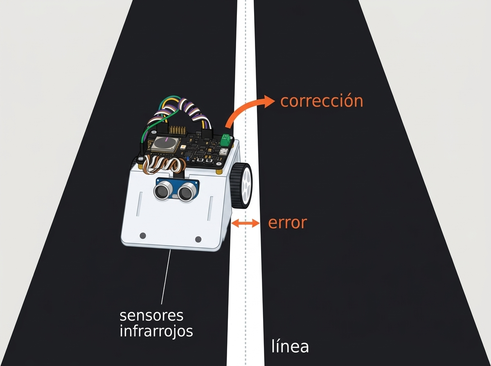

# Control Proporcional

> Este archivo pertenece a: **Robótica Avanzada**
> Ruta: `01. Bloques Temáticos/08. Robótica Avanzada/01. Control De Precisión/02. Control Proporcional.md`

---

## Estado

**Estado:** Borrador
**Versión:** v1.0
**Bloque:** 08. Robotica Avanzada

---

## Descripción

El control proporcional es la idea de que un robot no tiene que decidir "todo o nada" cuando se está corrigiendo. En lugar de encender y apagar, mira qué tan grande es el error y responde con una fuerza proporcional a ese error: mucho error, mucha corrección; poco error, poca corrección. Con eso el Sumobot deja de zigzaguear y llega al objetivo suavemente.

**Si el control proporcional fuera estacionar un carro: nadie llega al espacio y frena de golpe. Se suelta el acelerador cuando falta un metro, se frena un poco más cuando faltan veinte centímetros y se frena del todo cuando ya casi toca. La fuerza que se aplica es proporcional a lo que falta. El robot hace exactamente eso con sus motores.**



> *Pie de foto sugerido: el Sumobot en la cancha siguiendo la línea, con una flecha marcando cuánto se desvió del centro.*

---

## Propósito

Que el docente pueda explicar qué es un error de seguimiento, cómo se convierte ese error en una velocidad de corrección mediante una constante proporcional, cómo se ajusta esa constante probando el robot y cómo se compara este control con una regla de encendido y apagado.

---

## Contenido

### De dónde venimos

En los bloques anteriores el robot aprendió a moverse: a encender motores, a leer sus sensores y a reaccionar a lo que encuentra. En el tema anterior, Calibración Avanzada, el robot aprendió a medir su propio error y a restarlo de las lecturas, para que el giroscopio dijera la verdad.

Ahora el robot ya tiene sensores confiables, pero todavía le falta una forma de decidir **cuánto** corregir. La regla de encendido y apagado que usaba antes funciona, pero tiene un problema visible: el robot nunca va recto. Va corrigiendo a saltos, oscilando alrededor de su objetivo como un carro manejado por alguien que solo sabe girar el volante a fondo. Además, la corrección no depende de cuánto se desvió: da igual estar un milímetro fuera de la línea o estar completamente perdido, la respuesta es la misma.

El control proporcional cambia esa regla por una que sí mira cuánto se desvió.

---

### Qué es el error

El **error** es la distancia entre donde está el robot y donde debería estar. En el seguimiento de línea, el error es qué tan lejos está el robot del centro de la línea.

El Sumobot trae cuatro sensores infrarrojos apuntando hacia abajo, en los pines IO36, IO39, IO34 e IO35. Cada uno reporta si ve blanco o negro, y con esa información se puede estimar dónde está el robot respecto a la línea.

En el código del Sumobot los sensores se leen así:

```python
sen1 = ib.AnalogIn(board.IO36)  # adelante izquierdo
sen2 = ib.AnalogIn(board.IO39)  # adelante derecho
sen3 = ib.AnalogIn(board.IO34)  # atrás izquierdo
sen4 = ib.AnalogIn(board.IO35)  # atrás derecho

infrarrojos = [sen1, sen2, sen3, sen4]
```

Y se convierten a 0 o 1 con un umbral:

```python
# arreglo de 0 y 1s (0-blanco, 1-negro)
def leer_sensores(infrarrojos, valor_critico=10000):
    return [int(sen.value < valor_critico) for sen in infrarrojos]
```

El umbral `valor_critico` es un ajuste de calibración: si el robot lee negro donde hay blanco, el umbral está mal.

Con los dos sensores frontales se puede armar una posición aproximada:

| Sensor izquierdo | Sensor derecho | Posición estimada | Error |
|---|---|---|---|
| Blanco (0) | Blanco (0) | Centrado sobre la línea | 0 |
| Negro (1) | Blanco (0) | Desviado a la izquierda | −1 |
| Blanco (0) | Negro (1) | Desviado a la derecha | +1 |
| Negro (1) | Negro (1) | Sobre la línea o perdido | Se revisa |

El signo importa: negativo significa que el robot está a la izquierda de la línea y tiene que girar a la derecha para volver. Positivo significa lo contrario.

---

### La fórmula del control proporcional

La corrección se calcula con una multiplicación:

\[ \text{corrección} = K_p \times \text{error} \]

`K_p` es la **constante proporcional**: un número que decide cuánta fuerza se aplica por cada unidad de error. Es el único número que hay que ajustar, y de él depende todo el comportamiento del robot.

La corrección se reparte entre los dos motores:

\[ \text{velocidad izquierda} = \text{velocidad base} + \text{corrección} \]
\[ \text{velocidad derecha} = \text{velocidad base} - \text{corrección} \]

Si el robot está a la izquierda de la línea, el error es negativo, la corrección es negativa, el motor izquierdo se frena y el derecho acelera: el robot gira a la derecha y vuelve a la línea. Y al revés.

---

### Por qué se llama proporcional

Porque la corrección es **proporcional** al error. Esta es la diferencia con una regla de encendido y apagado:

| Situación | Control todo o nada | Control proporcional |
|---|---|---|
| Robot casi centrado | Corrige igual que si estuviera perdido | Corrige poquito |
| Robot muy desviado | Corrige igual que si estuviera centrado | Corrige mucho |
| Robot justo en la línea | Sigue recto | No corrige nada |
| Movimiento resultante | Zigzag | Trayectoria suave |

El robot con control todo o nada no podía ir suave porque su única respuesta era "girar a fondo". El robot con control proporcional modula la respuesta según lo que necesita.

---

### Cómo se elige K_p

`K_p` no sale de una fórmula: sale de probar. Es un ajuste de calibración, igual que el drift del giroscopio en el tema anterior, pero en lugar de medir un error del sensor se ajusta una ganancia.

- **Si `K_p` es muy pequeño**, el robot corrige muy poco y se sale de la línea en las curvas. Se ve lento y torpe.
- **Si `K_p` es muy grande**, el robot corrige demasiado, se pasa al otro lado y vuelve a corregir: oscila. Se ve nervioso y tembloroso.
- **Si `K_p` está bien**, el robot corrige rápido pero sin pasarse. La trayectoria se ve suave.

El procedimiento para encontrarlo es empezar con un valor bajo, subirlo poco a poco y anotar qué pasa. Nunca se ajusta a ojo sin probar el robot.

---

### Hoja de registro

Cada grupo anota sus pruebas con distintos valores de `K_p`:

| Prueba | K_p | Velocidad base | Comportamiento observado | ¿Sirve? |
|---|---|---|---|---|
| 1 | 0.05 | 0.5 | Se sale en la primera curva | No |
| 2 | 0.10 | 0.5 | Sigue la línea, lento en las curvas | Sí |
| 3 | 0.15 | 0.5 | Sigue bien, un poco de temblor | Sí |
| 4 | 0.40 | 0.5 | Oscila fuerte, se sale recto | No |

Ojo con las unidades: en el Sumobot la velocidad de los motores va de −1 a 1, no de 0 a 100. Por eso los valores de `K_p` que sirven son números pequeños como 0.15, y no valores como 0.8.

La velocidad base también importa: un mismo `K_p` que funciona a velocidad 0.5 puede fallar a velocidad 0.9, porque el robot tiene menos tiempo para corregir. Conviene ajustar `K_p` a la velocidad de competencia, no a una velocidad cómoda.

---

### Un detalle importante: el Sumobot ya usa control proporcional

El archivo `code_PDI.py` del Sumobot trae un controlador para avanzar recto. Este es el fragmento donde se calcula la corrección:

```python
error = sensor.gyro[2] - drift
error_integral += error * dt
error_derivativo = (error - error_anterior) / dt
correccion = Kp * error + Ki * error_integral + Kd * error_derivativo
```

Ahí están los tres términos juntos: el proporcional (`Kp * error`), el integral (`Ki * error_integral`) y el derivativo (`Kd * error_derivativo`). En este tema interesa el primero, porque es el que hace el trabajo principal.

Y este es el fragmento donde la corrección se reparte entre los motores:

```python
v1 = velocidad_base * direccion + correccion
v2 = velocidad_base * direccion - correccion
ib.motor_1.throttle = v1
ib.motor_2.throttle = v2
```

Es exactamente la fórmula de arriba. La diferencia es que aquí el error no es la desviación respecto a la línea, sino la velocidad de giro que marca el giroscopio: si el robot empezó a girar aunque debería ir recto, ese giro es el error y se corrige.

El archivo `code_line_follow.py` hace lo mismo pero con la línea, y ahí `K_p` está escrita a mano como `corr = 0.1`. En la práctica guiada se pide justamente eso: probar varios valores y anotar el comportamiento.

---

### Un controlador incompleto a propósito

En `straight_move` hay una línea que llama la atención:

```python
dt = 1 #t_actual - t_anterior
```

El término derivativo está desactivado: en lugar de calcular el tiempo real entre lecturas, se usa un 1 fijo. Eso significa que el controlador no está midiendo qué tan rápido cambia el error, así que no puede anticipar el frenado. Es un controlador proporcional e integral, con la parte derivativa pendiente.

No es un error del código del Sumobot: es una decisión de diseño para que el robot sea más simple de entender en el curso. Pero sirve para que los estudiantes vean cómo se ve un controlador al que le falta una pieza, y por qué el robot se pasa un poco del objetivo cuando gira rápido.

---

### Las tres versiones del mismo programa

El objetivo es el mismo en las tres: **seguir una línea corrigiendo la velocidad de los motores según el error, con una constante proporcional ajustable**.

#### Versión 1: CircuitPython

Es el código que corre en la IdeaBoard del Sumobot. Usa la librería `ideaboard`, que ya viene en la placa. El código se puede escribir y cargar desde [IdeaCode](https://ideacode.crcibernetica.com/).

```python
# Control proporcional para el seguimiento de línea del Sumobot (CircuitPython)
import board
import time
from ideaboard import IdeaBoard

# Constantes
KP = 0.15                     # constante proporcional; ajustar probando
VELOCIDAD_BASE = 0.5          # velocidad de avance, de 0 a 1
CORRECCION_MAXIMA = 0.4       # límite para no sobrecorregir
PAUSA = 0.01                  # segundos entre correcciones
UMBRAL_IR = 10000             # umbral de los sensores infrarrojos

# Inicialización
ib = IdeaBoard()

# Sensores infrarrojos frontales: izquierdo y derecho
sen_izq = ib.AnalogIn(board.IO36)
sen_der = ib.AnalogIn(board.IO39)


def leer_sensores():
    """Devuelve (izquierdo, derecho) con 0 para blanco y 1 para negro."""
    izq = int(sen_izq.value < UMBRAL_IR)
    der = int(sen_der.value < UMBRAL_IR)
    return izq, der


def calcular_error(izq, der):
    """Convierte la lectura de los dos sensores en un error.
    Negativo: el robot está a la izquierda. Positivo: a la derecha.
    Devuelve None si perdió la línea."""
    if izq == 0 and der == 0:
        return 0            # centrado
    if izq == 1 and der == 0:
        return -1           # desviado a la izquierda
    if izq == 0 and der == 1:
        return 1            # desviado a la derecha
    return None             # los dos ven negro: línea perdida


def limitar(valor, minimo, maximo):
    """Evita que una velocidad salga del rango permitido."""
    return max(minimo, min(maximo, valor))


# ------------------------------
# PROGRAMA PRINCIPAL
# ------------------------------
print(f"Control proporcional con Kp = {KP}")
ib.pixel = (0, 255, 0)

while True:
    izq, der = leer_sensores()
    error = calcular_error(izq, der)

    if error is None:
        # Perdió la línea: se detiene y avisa.
        ib.motor_1.throttle = 0
        ib.motor_2.throttle = 0
        ib.pixel = (255, 0, 0)
        print("Línea perdida")
        time.sleep(PAUSA)
        continue

    correccion = KP * error              # la fórmula del control proporcional
    correccion = limitar(correccion, -CORRECCION_MAXIMA, CORRECCION_MAXIMA)

    izquierda = limitar(VELOCIDAD_BASE + correccion, -1, 1)
    derecha = limitar(VELOCIDAD_BASE - correccion, -1, 1)

    ib.motor_1.throttle = izquierda
    ib.motor_2.throttle = derecha
    time.sleep(PAUSA)
```


> *Pie de foto sugerido: captura de IdeaCode con el archivo abierto, la constante `KP` resaltada y la consola mostrando el error y la corrección en cada vuelta.*

#### Versión 2: C++ de Arduino (opción alternativa)

Para quienes prefieran programar la IdeaBoard desde el IDE de Arduino. Los pines son los mismos que usa el código de CircuitPython.

```cpp
// Control proporcional para el seguimiento de línea del Sumobot (C++ de Arduino)
#include <Wire.h>

// Constantes
const float KP = 0.15;                 // constante proporcional; ajustar probando
const float VELOCIDAD_BASE = 0.5;      // velocidad de avance, de 0 a 1
const float CORRECCION_MAXIMA = 0.4;   // límite para no sobrecorregir
const int PAUSA_MS = 10;               // milisegundos entre correcciones
const int UMBRAL_IR = 10000;           // umbral de los sensores infrarrojos

// Pines de los sensores infrarrojos frontales
const int PIN_SEN_IZQ = 36;            // IO36, adelante izquierdo
const int PIN_SEN_DER = 39;            // IO39, adelante derecho

float limitar(float valor, float minimo, float maximo) {
  if (valor < minimo) return minimo;
  if (valor > maximo) return maximo;
  return valor;
}

// Lee los dos sensores frontales. 0 es blanco, 1 es negro.
void leerSensores(int &izq, int &der) {
  izq = (analogRead(PIN_SEN_IZQ) < UMBRAL_IR) ? 1 : 0;
  der = (analogRead(PIN_SEN_DER) < UMBRAL_IR) ? 1 : 0;
}

// Convierte la lectura en un error.
// Devuelve 99 si el robot perdió la línea.
int calcularError(int izq, int der) {
  if (izq == 0 && der == 0) return 0;    // centrado
  if (izq == 1 && der == 0) return -1;   // desviado a la izquierda
  if (izq == 0 && der == 1) return 1;    // desviado a la derecha
  return 99;                             // línea perdida
}

// Ajustar según la librería de motores que use la placa
void mover(float izquierda, float derecha) {
  // El throttle va de -1 a 1, igual que en CircuitPython
  // ledcWrite o analogWrite según el pin usado
}

void setup() {
  Serial.begin(115200);
  pinMode(PIN_SEN_IZQ, INPUT);
  pinMode(PIN_SEN_DER, INPUT);
  Serial.print("Control proporcional con Kp = ");
  Serial.println(KP, 2);
}

void loop() {
  int izq, der;
  leerSensores(izq, der);
  int error = calcularError(izq, der);

  if (error == 99) {
    mover(0, 0);
    Serial.println("Línea perdida");
    delay(PAUSA_MS);
    return;
  }

  float correccion = KP * error;         // la fórmula del control proporcional
  correccion = limitar(correccion, -CORRECCION_MAXIMA, CORRECCION_MAXIMA);

  float izquierda = limitar(VELOCIDAD_BASE + correccion, -1, 1);
  float derecha = limitar(VELOCIDAD_BASE - correccion, -1, 1);

  mover(izquierda, derecha);
  delay(PAUSA_MS);
}
```

#### Versión 3: bloques de IdeaScratch (puente didáctico)

En [IdeaScratch](https://ideascratch.crcibernetica.com/) el programa se arma con esta estructura de bloques:

```
al iniciar
    poner el pixel en verde
    fijar kp en 0.15
    fijar velocidad base en 0.5
    por siempre
        fijar sensor izquierdo en (leer sensor IO36)
        fijar sensor derecho en (leer sensor IO39)
        si sensor izquierdo = 0 y sensor derecho = 0 entonces
            fijar error en 0
        si no
            si sensor izquierdo = 1 y sensor derecho = 0 entonces
                fijar error en −1
            si no
                si sensor izquierdo = 0 y sensor derecho = 1 entonces
                    fijar error en 1
                si no
                    fijar error en "perdido"
        si error = "perdido" entonces
            detener motores
            poner el pixel en rojo
        si no
            fijar correccion en kp × error
            fijar velocidad izquierda en velocidad base + correccion
            fijar velocidad derecha en velocidad base − correccion
            mover motor 1 a velocidad izquierda
            mover motor 2 a velocidad derecha
        esperar 0.01 segundos
```

Los nombres exactos de los bloques dependen de la versión de IdeaScratch. El panel **Generated CircuitPython** muestra el código que producen los bloques, y sirve para comprobar que hacen lo mismo que el programa de la versión 1.


> *Pie de foto sugerido: los bloques del control proporcional armados a la izquierda y el panel "Generated CircuitPython" a la derecha.*


> *Pie de foto sugerido: el bloque que lee el valor de un sensor infrarrojo, ampliado, con el umbral señalado.*


> *Pie de foto sugerido: el bloque de movimiento con las dos velocidades calculadas, ampliado.*


> *Pie de foto sugerido: el simulador de IdeaScratch con la trayectoria del robot y el valor de `kp` a la vista.*

El control proporcional sí se puede probar en el simulador, porque no depende de un sensor que se desvía sino de la posición del robot respecto a la línea. Conviene usarlo para comparar dos valores de `kp` sin gastar batería.

---

### Cómo probar los códigos

Antes de ajustar `K_p` hay que asegurarse de que el robot hace lo que se espera. Estas son las tres formas de probarlo, en el mismo orden en que se presentan los códigos.

#### Probar la versión de CircuitPython

1. Conectar el Sumobot por USB a la computadora.
2. Abrir [IdeaCode](https://ideacode.crcibernetica.com/) y crear un archivo nuevo. Copiar el programa de la versión 1.
3. Verificar que la placa esté conectada y que el puerto aparezca en el selector. Si no aparece, revisar el cable USB: algunos cables solo cargan y no transmiten datos.
4. Cargar el programa y abrir la consola. Debe aparecer el mensaje con el valor de `K_p`.
5. Poner el robot sobre la pista, con la línea entre los dos sensores frontales, y encenderlo.
6. Observar el pixel: verde significa que está leyendo la línea, rojo que la perdió.
7. Empujar el robot un poco hacia un lado, sin levantarlo, y ver si corrige. Si corrige hacia el lado equivocado, el signo del error está invertido.
8. Anotar en la hoja de registro el valor de `K_p` y el comportamiento observado, antes de cambiarlo.

Para ver el error y la corrección en vivo, se agrega un `print` dentro del bucle:

```python
print(f"izq={izq} der={der} error={error} correccion={correccion:.3f}")
```

Conviene probar primero con el robot levantado del piso y las ruedas al aire, girando los sensores a mano sobre una hoja con una línea negra. Así se ve la reacción sin que el robot se escape de la mesa.

#### Probar la versión de C++ de Arduino

1. Instalar el [Arduino IDE](https://www.arduino.cc/en/software) y el soporte para placas ESP32 desde el Gestor de Placas.
2. Instalar la librería de motores que use la IdeaBoard. El docente confirma cuál es.
3. Completar la función `mover()` con las llamadas reales de la placa. Mientras esté vacía, el robot no se mueve y el programa no sirve para probar.
4. Conectar el robot por USB, elegir la placa ESP32 y el puerto en el IDE.
5. Cargar el programa y abrir el Monitor Serial a 115200 baudios.
6. Confirmar que aparece el mensaje con el valor de `K_p` y que no hay errores de compilación.
7. Probar primero con las ruedas al aire, girando los sensores a mano, y después en la pista.

El Monitor Serial es la consola de esta versión: los `Serial.println` cumplen el papel de los `print` de CircuitPython. Si el robot se comporta distinto que en la versión 1, casi siempre es porque `mover()` no traduce bien el rango de −1 a 1.

#### Probar la versión de bloques de IdeaScratch

1. Abrir [IdeaScratch](https://ideascratch.crcibernetica.com/) y armar los bloques en el orden de la estructura de arriba.
2. Revisar el panel **Generated CircuitPython** y compararlo con la versión 1. Si el código generado no coincide, hay un bloque mal acomodado.
3. Usar el simulador para ver la trayectoria con distintos valores de `kp`, sin gastar batería.
4. Conectar la placa y cargar el programa para probarlo en el robot físico, igual que en las otras dos versiones.

El simulador sirve para comparar valores de `kp` y ver la trayectoria, pero no reemplaza la prueba en la pista: el ruido de los sensores y el rozamiento de las ruedas solo aparecen en el robot real.

#### Qué mirar en las tres versiones

| Qué revisar | Cómo se ve cuando está bien | Qué hacer si falla |
|---|---|---|
| El robot lee la línea | Pixel verde sobre la pista | Ajustar el umbral `UMBRAL_IR` |
| El robot corrige hacia el lado correcto | Se endereza al desviarlo | Invertir el signo del error |
| El robot no se sale en las curvas | Trayectoria suave y continua | Subir `K_p` poco a poco |
| El robot no oscila | Sin temblor ni zigzag | Bajar `K_p` |
| Las velocidades no se disparan | El robot no gira en el lugar | Revisar el límite de corrección |

Si el robot no se mueve en absoluto, antes de tocar `K_p` hay que revisar la conexión de los motores y el orden de los pines. Un `K_p` mal ajustado hace que el robot se mueva mal, pero nunca que se quede completamente quieto.

---

### Tabla de equivalencia entre lenguajes

| Idea | CircuitPython | C++ de Arduino | Bloques de IdeaScratch |
|---|---|---|---|
| Leer un sensor | `int(sen_izq.value < UMBRAL_IR)` | `analogRead(PIN_SEN_IZQ) < UMBRAL_IR` | leer sensor IO36 |
| Calcular el error | `calcular_error(izq, der)` | `calcularError(izq, der)` | si izquierdo = 1 entonces −1 |
| Aplicar la constante | `correccion = KP * error` | `float correccion = KP * error;` | kp × error |
| Repartir la corrección | `VELOCIDAD_BASE + correccion` | `VELOCIDAD_BASE + correccion` | velocidad base + correccion |
| Limitar la velocidad | `limitar(valor, -1, 1)` | `limitar(valor, -1, 1)` | si velocidad > 1 entonces 1 |
| Mover los motores | `ib.motor_1.throttle = izquierda` | `mover(izquierda, derecha)` | mover motor 1 a velocidad |
| Repetir siempre | `while True:` | `void loop()` | por siempre |
| Pausa entre correcciones | `time.sleep(0.01)` | `delay(10);` | esperar 0.01 segundos |
| Ver qué está pasando | `print(...)` | `Serial.println(...)` | mostrar variable en pantalla |

---

### Qué pasa si el robot pierde la línea

Cuando los dos sensores frontales ven negro, el error no está definido y la fórmula no sirve. Hay tres respuestas posibles, y conviene que el grupo elija una y la justifique:

1. **Detenerse y avisar.** Es la más simple y la que se usa en el código de arriba. El robot se queda quieto con el pixel rojo y espera.
2. **Girar buscando.** El robot gira sobre su eje en la dirección de la última corrección, hasta volver a encontrar la línea. El Sumobot ya trae una función `wiggle` que hace zigzag buscando la línea.
3. **Seguir de largo.** El robot mantiene la última corrección y avanza, con la esperanza de reencontrar la línea. Es la más arriesgada.

En una competencia, la respuesta 2 suele ser la mejor, porque un robot detenido pierde. Pero la respuesta 1 es la que conviene para aprender, porque hace visible el problema.

---

### Por qué el control proporcional no es suficiente

El control proporcional corrige según cuánto se desvió, pero no mira qué tan rápido se está desviando. Eso significa que siempre llega un poco tarde: cuando el robot ya está en la línea, todavía trae velocidad lateral y se pasa al otro lado. Es el mismo problema del carro que frena justo cuando llega al espacio y se pasa un poco.

La solución clásica es agregar un término que mida la velocidad del cambio del error, el término **derivativo**, que anticipa el frenado. Con eso el controlador se llama PD, y si además se acumula el error en el tiempo, PDI. El Sumobot trae el término derivativo desactivado a propósito, como se vio más arriba, así que queda como mejora pendiente.

Más adelante, en Odometría Básica, el robot aprenderá a saber dónde está sin depender de la línea, y el control proporcional se usará para llegar a un punto en lugar de para seguir un trazo.

---

## Recursos relacionados

- [Calibración Avanzada](01.%20Calibracion%20Avanzada.md)
- [Encoders](03.%20Encoders.md)
- [IdeaCode](https://ideacode.crcibernetica.com/) — para escribir y cargar el código de CircuitPython.
- [IdeaScratch](https://ideascratch.crcibernetica.com/) — para la versión en bloques y el simulador.
- [Arduino IDE](https://www.arduino.cc/en/software) — para la versión alternativa en C++.
- El archivo `code_PDI.py` del Sumobot, con las ganancias `Kp`, `Ki` y `Kd`.

---

## Notas docentes

El error más común es ajustar `K_p` mirando el robot y no la hoja de registro. El grupo sube el valor, el robot se ve "más rápido" y lo dejan ahí, sin notar que en la siguiente curva se sale. Conviene exigir que cada prueba quede anotada con el valor de `K_p`, la velocidad base y una descripción del comportamiento, antes de pasar a la siguiente.

Vale la pena hacer visible la oscilación. Pida a un grupo que ponga `K_p` en 0.5 y filme el robot con el celular. Al reproducirlo en cámara lenta, el zigzag se ve clarísimo y el grupo entiende por qué un valor alto es peor que uno bajo. Después se compara con el video de `K_p` en 0.15, y la diferencia no necesita explicación.

Un detalle que su
