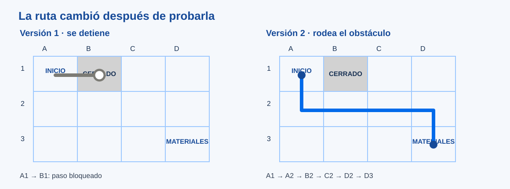

# Instrucciones que otra persona puede seguir

> Este archivo pertenece a: **B09 Programación · Instrucciones y Algoritmos**

> Ruta: `01. Bloques Temáticos/09. Programación/01. Instrucciones y Algoritmos/instrucciones-que-se-pueden-probar.md`

---

## Estado

**Estado:** En revisión

**Versión:** v0.1

**Bloque:** 09_programacion

**Última actualización:** 2026-10-26

---

## Descripción

Una persona puede comprender el propósito de una tarea y aun así ejecutar pasos distintos de los que imaginó quien los escribió. Este documento ofrece al personal docente criterios para trabajar instrucciones, secuencias y algoritmos a partir de un recorrido del makerspace. La precisión se descubre al poner las instrucciones a prueba, no memorizando primero una definición.

## Propósito

Orientar una mediación en la que el grupo pase de «yo sé llegar» a «otra persona puede llegar con las indicaciones que hice», distinga intención de resultado y documente una mejora vinculada con una observación.

## Contenido

### 1. Instruir requiere un punto de partida

«Caminá dos pasos y girá a la izquierda» parece claro, pero falta saber hacia dónde mira la persona al empezar, qué cuenta como paso y si el camino está libre. En una computadora ocurre algo parecido: un programa recibe un estado inicial, ejecuta instrucciones según reglas definidas y produce un resultado. Si el estado o la regla no están claros, distintas personas pueden anticipar resultados diferentes.

En la actividad, fije un **inicio** y una **orientación** visibles. Acordar «un paso = moverse una casilla» evita que cada equipo mida de manera distinta. Esta definición sencilla es parte del programa; no es una ayuda escondida que se agrega después de que alguien se pierde.

| Frase inicial | Duda que deja | Versión comprobable |
| --- | --- | --- |
| «Ve a los materiales». | ¿Dónde están? ¿Desde dónde empezás? | «Inicia en A1 mirando hacia la fila 3; avanza una casilla hacia A2». |
| «Girás y seguís». | ¿En qué punto y hacia qué lado? | «En A2, gira a la derecha y pasa a B2». |
| «Si no podés, buscá otro camino». | ¿Qué cuenta como obstáculo? | Primero marque el obstáculo y pida al equipo que diseñe una nueva ruta que pueda probarse. |

La última frase es una oportunidad para descomponer el problema. Evite presentar una condición compleja antes de que el grupo pueda mostrar dónde y por qué falla la primera ruta.

### 2. Algoritmo, secuencia y resultado

En este bloque llamamos **algoritmo** a una serie finita y ordenada de instrucciones para cumplir una tarea, con un inicio definido y un resultado verificable. No todo algoritmo tiene que ser código. Una receta, una ruta o un conjunto de tarjetas puede servir si otra persona sabe cómo ejecutarlo.

Considere una cuadrícula de cuatro columnas (A–D) y tres filas (1–3). El visitante empieza en A1; B1 está cerrado y la mesa de materiales está en D3. Una ruta posible es:

1. Desde A1, bajar a A2.
2. Moverse a B2.
3. Moverse a C2.
4. Moverse a D2.
5. Bajar a D3.

El destino es el mismo si se elige otro camino válido. Esa posibilidad permite comparar soluciones por claridad y seguridad, no declarar «incorrecta» una ruta distinta solo porque no coincide con la del docente. Si alguien intenta entrar en B1, el resultado de esa prueba es **obstáculo encontrado**, no un fallo personal.

*Figura. Dos versiones del mismo propósito muestran por qué importa observar el recorrido real.*

### 3. Predecir y probar

Antes de entregar una ruta, cada equipo señala dónde cree que terminará el visitante. Luego otra persona la sigue **sin que el autor intervenga**. Quien observa anota o dibuja el primer punto de desacuerdo. Si la secuencia no llega a la mesa, el equipo cambia una instrucción y pide una segunda ejecución.

Se comparan tres cosas:

| Registro | Pregunta docente |
| --- | --- |
| Lo que el equipo quiso indicar | ¿Qué destino y orientación habían imaginado? |
| Lo que la otra persona hizo | ¿Qué instrucción leyó y desde qué posición? |
| Lo que cambió en la nueva versión | ¿El cambio atiende esa diferencia concreta? |

Un buen resultado no exige acertar a la primera. Exige poder relacionar una mejora con una prueba. En una representación digital, el equivalente puede ser detener la ejecución después de cada paso, observar el estado y localizar la primera diferencia entre lo esperado y lo ocurrido.

### 4. Descomponer antes de agregar complejidad

Si una ruta larga cuesta revisar, divídala en tramos: **salir del inicio**, **rodear el obstáculo** y **llegar a destino**. Pruebe cada tramo por separado. Esta es una forma accesible de descomposición: convertir una tarea en partes cuya función se pueda explicar.

Cuando el grupo detecta tres pasos consecutivos hacia el mismo lado, puede decir «se repite». En niveles iniciales basta reconocer el patrón con tarjetas. En niveles posteriores, una repetición programada ahorra instrucciones, pero solo si se conoce cuántas veces debe ocurrir y cómo se detiene. El capítulo de [bloques](../02.%20Programaci%C3%B3n%20por%20Bloques/README.md) retoma esa idea.

La descomposición no debe volver idénticos todos los proyectos. El estudiantado puede proponer otro destino o agregar una necesidad de accesibilidad, como una indicación que funcione sin depender del color de las estaciones.

### 5. Profundidad según el nivel

| Nivel | Pregunta adecuada | Evidencia observable |
| --- | --- | --- |
| **Exploradores** | ¿Cuál tarjeta va primero para llegar a la mesa? | Señala o explica un cambio después de probar. |
| **Inventores** | ¿En qué instrucción se fue por otro camino? | Reordena la secuencia y vuelve a entregar las tarjetas. |
| **Creadores** | ¿Qué parte puede probarse sola? | Divide una ruta en tramos y compara dos versiones. |
| **Diseñadores** | ¿Qué estado inicial y reglas necesita quien ejecuta? | Registra una traza y un caso que provoca un error. |
| **Innovation Lab** | ¿Cómo representaría la ruta para que pueda revisarse y cambiarse? | Justifica datos, casos de prueba y límites de la solución. |

El grado orienta la profundidad. No se pide usar una cuadrícula escrita en preescolar: se puede construir con cinta, figuras y estaciones físicas.

## Aplicación en Maker Academy

### Inspiración

Empiece por una indicación cotidiana que dos personas interpreten de manera distinta. Pregunte a quién sirve la ruta y qué debe saber antes de empezar. Los equipos proponen un criterio de éxito que otra persona pueda comprobar.

### Experimentación

Deje que un equipo construya y otro ejecute. Alterne roles. Si una instrucción lleva a B1, invite a identificar el primer paso conflictivo. Prepare una segunda prueba después de cambiar la tarjeta, sin corregir oralmente la ruta durante la ejecución.

### Reflexión y evaluación formativa

Compare dos versiones de la secuencia y pida que el equipo explique **qué observación motivó el cambio**. La evidencia puede ser una foto de tarjetas sin estudiantes identificables, un dibujo del recorrido o una tabla de pasos. Una retroalimentación útil sería: «La ruta llega, pero quien la siguió no sabía hacia dónde mirar al principio. ¿Cómo lo aclararías y con quién la volverías a probar?».

## Recursos relacionados

- [Práctica de la ruta del visitante](practica-ruta-del-visitante.md).
- [Mapa de progresión](../01.%20Mapa%20de%20Progresi%C3%B3n.md).
- [Evidencias y evaluación del bloque](../07.%20Evaluaci%C3%B3n/README.md).

## Imagen sugerida

Proyectar la [ruta de dos versiones](../imagenes/ruta-probada.svg) después de la primera prueba, no antes de que los equipos propongan su camino. Su texto alternativo identifica inicio, obstáculo, desvío y destino; el contraste y las etiquetas permiten leerla sin distinguir colores.

## Nota docente

No confunda precisión con una única respuesta correcta. Una ruta diferente puede resolver bien la necesidad. La pregunta central es si otra persona la puede seguir bajo reglas acordadas y si el equipo logra explicar por qué cambió una instrucción.
