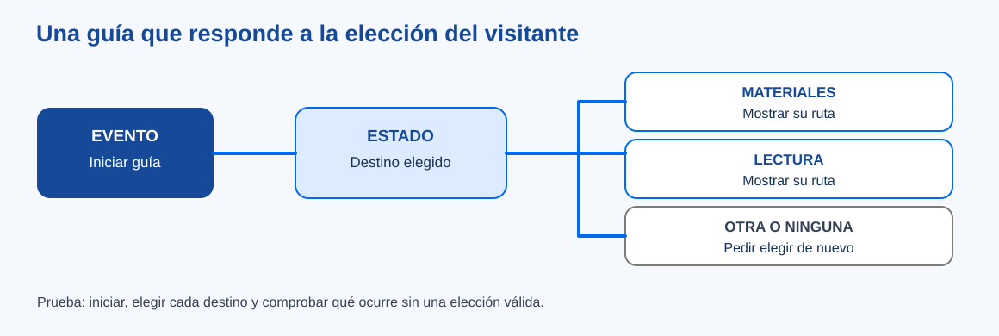

# Eventos, decisiones y repeticiones en una creación propia

> Este archivo pertenece a: **B09 Programación · Programación por Bloques**

> Ruta: `01. Bloques Temáticos/09. Programación/02. Programación por Bloques/eventos-decisiones-y-repeticiones.md`

---

## Estado

**Estado:** En revisión

**Versión:** v0.1

**Bloque:** 09_programacion

**Última actualización:** 2026-10-26

---

## Descripción

En un programa por bloques, «hacer algo» puede depender de cuándo se inicia, de una elección y de información que cambia durante la ejecución. Este recurso distingue esas ideas con una guía para visitantes del makerspace. Sirve para preparar la mediación aunque el entorno use nombres de bloques diferentes.

## Propósito

Ayudar al personal docente a relacionar un comportamiento esperado con sus componentes, anticipar errores frecuentes y pedir pruebas que muestren comprensión de eventos, estado, condiciones y repeticiones.

## Contenido

### 1. El evento responde a «¿cuándo?»

Una guía puede mostrar un saludo **al presionar iniciar** y ofrecer un destino **al seleccionar una opción**. Esos son eventos distintos. Antes de construir, pida que el grupo dibuje qué ve el visitante al abrir la guía y qué ocurre después de actuar. Si el personaje responde antes de que alguien elija, revise qué evento puso en marcha esa acción.

Una secuencia ejecuta acciones en orden *después* del evento. Por ejemplo: mostrar la pregunta, recibir una elección y dar una indicación. El evento no decide por sí mismo cuál destino mostrar; eso le corresponde a una regla que usa la respuesta.

### 2. La decisión usa información disponible

Llame **estado** a la información que el programa conserva en un momento: destino elegido, mensaje visible o posición del personaje. Una condición pregunta por parte de ese estado: «si el destino es materiales, mostrar ruta A; si es lectura, mostrar ruta B». El programa debe dar una respuesta comprensible cuando no haya selección o llegue un valor diferente. No conviene asumir que todo visitante elegirá una de las opciones esperadas.

| Prueba del visitante | Estado o entrada | Respuesta que se espera |
| --- | --- | --- |
| Elige materiales. | `destino = materiales` | Indicaciones hacia la mesa de materiales. |
| Elige lectura. | `destino = lectura` | Indicaciones hacia la estación de lectura. |
| No elige o el dato no se reconoce. | `destino` vacío u otro valor. | Pedir una elección válida, sin inventar una ruta. |

En un entorno de bloques, estas respuestas pueden representarse con mensajes y ramas «si / si no». En una herramienta con botones puede bastar con dos eventos distintos y un mensaje inicial. Compare ambas implementaciones por su comportamiento, sin imponer una estructura interna idéntica. Si usa una variable, inicialícela antes de leerla y pruebe qué ocurre al reiniciar.

### 3. La repetición necesita propósito y salida

Un patrón de movimiento repetido puede representarse con un bucle de cantidad conocida. Una guía que pregunta hasta recibir una respuesta válida necesita un criterio de salida. No agregue un bucle solo para que el programa parezca más avanzado: pregunte **qué se repite, cuántas veces o hasta cuándo, y qué cambia en cada vuelta**.

Si el visitante puede intentar de nuevo, el programa vuelve a mostrar la pregunta y espera una entrada nueva. Si no espera o no actualiza el estado, repetirá el mismo mensaje indefinidamente. Una prueba breve consiste en seleccionar una opción inválida y luego una válida: la guía debería recuperar la interacción y terminar mostrando la ruta correcta.

### 4. Rastrear una ejecución

Antes de mover bloques al azar, detenga el programa en tres puntos: evento recibido, valor de la elección y respuesta mostrada. Registre la primera diferencia entre lo predicho y lo observado.

| Paso | Predicción | Observación | Cambio propuesto |
| --- | --- | --- | --- |
| Se pulsa iniciar. | Aparece la pregunta. | Aparece una ruta antigua. | Restablecer mensaje y elección al comienzo; probar otra vez. |
| Se elige lectura. | Aparece ruta B. | Aparece ruta A. | Revisar qué valor compara la rama, sin cambiar el resto. |

El ejemplo de la tabla ilustra una hipótesis. Cada equipo registra lo que ocurrió de verdad en su entorno. Una captura del bloque y una explicación oral pueden sustituir la tabla en primaria.

### 5. Del bloque al texto

En 7.º–9.º, trace el mismo caso como «entrada → condición → respuesta» y compare con una versión de Python introductoria cuando el grupo esté listo. La equivalencia se comprueba con las **mismas tres pruebas**, no por parecido visual entre bloques y líneas. En 10.º–11.º, una función que recibe el destino y devuelve una indicación permite probar la decisión sin interfaz. La carpeta de transición a texto se desarrollará en una entrega posterior de B09.

## Aplicación en Maker Academy

### Inspiración

Presente una guía que solo funciona para un destino. Pregunte a quién deja sin respuesta y qué debería ocurrir antes de mostrar una ruta. El estudiantado decide cuáles destinos de su espacio tienen sentido.

### Experimentación

Los equipos prueban primero el evento y una respuesta; después agregan la segunda y la entrada inesperada. Entre cambios, una persona predice y otra opera el programa. Una prueba con alguien que no vio la construcción descubre supuestos que el equipo ya no nota.

### Reflexión y evaluación formativa

Solicite la primera predicción equivocada, una observación y el cambio que la atendió. Pregunte si el mensaje de error ayuda a seguir o si deja al visitante atrapado. Consulte la [práctica](practica-guia-interactiva.md) y el [registro de pruebas](../07.%20Evaluaci%C3%B3n/registro-de-pruebas.md).

## Recursos relacionados

- [Práctica: una guía interactiva](practica-guia-interactiva.md).
- [Instrucciones que otra persona puede seguir](../01.%20Instrucciones%20y%20Algoritmos/instrucciones-que-se-pueden-probar.md).
- [Herramientas para el Aula](../06.%20Herramientas%20para%20el%20Aula/README.md).

## Imagen sugerida

Use el [diagrama de la guía](../imagenes/evento-estado-bloques.svg) para discutir qué debe ocurrir con una elección inesperada. Las tres salidas están rotuladas.

## Nota docente

Si el entorno utiliza eventos separados para cada botón, no fuerce una variable solo para reproducir el ejemplo. La pregunta evaluable es si el estudiante puede explicar cuándo ocurre cada acción, qué elección la determina y qué pasa al probar un caso distinto.
