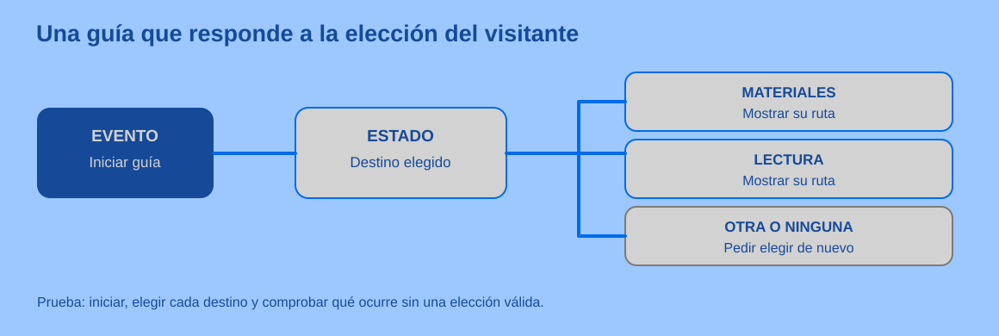

# Práctica guiada: una guía interactiva del makerspace

> Este archivo pertenece a: **B09 Programación · Programación por Bloques**

> Ruta: `01. Bloques Temáticos/09. Programación/02. Programación por Bloques/practica-guia-interactiva.md`

---

## Estado

**Estado:** En revisión

**Versión:** v0.1

**Bloque:** 09_programacion

**Última actualización:** 2026-11-05

---

## Descripción

Un equipo crea una guía breve para que una persona visitante elija entre dos lugares del makerspace. La guía muestra la indicación correspondiente y responde con claridad cuando no recibe una elección válida. Puede construirse con personajes, botones y mensajes en un entorno por bloques; también puede ensayarse con tarjetas antes de usar una pantalla.

## Propósito

Construir una interacción que tenga un inicio reconocible, dos respuestas distintas y una salida útil para una entrada inesperada. Probarla con otra persona, registrar una diferencia entre lo esperado y lo observado y mejorar la guía.

## Contenido

### 1. Preparación docente

**Nivel recomendado:** 4.º–6.º; adapte la primera parte a 1.º–3.º con una sola elección y apoyo de lectura. En 7.º–9.º use la misma interacción para rastrear estado y comparar después con texto. **Tiempo orientativo:** dos sesiones de 40–50 minutos.

Prepare tarjetas de dos destinos reales o imaginarios, papel para bosquejo y un entorno que permita iniciar una escena, recibir una elección y mostrar mensajes o mover un personaje. Sprite Lab es una opción si el grupo tiene acceso; no se exige una cuenta personal para comprender la actividad. Compruebe antes los dispositivos, idioma de la interfaz, modo de guardar y política institucional sobre cuentas. Si no hay conexión, un integrante hace de programa con tarjetas de «si elige…».

Acuerde un criterio de éxito que pueda observar otra persona: **al comenzar se ve la pregunta; materiales y lectura producen indicaciones diferentes; una respuesta no reconocida pide volver a elegir**. La longitud o decoración no forman parte del criterio.

### 2. Inspiración · una persona nueva en el espacio

Plantee la situación: «Alguien llega por primera vez y quiere encontrar la mesa de materiales o la zona de lectura». Muestre dos indicaciones breves, sin suponer que el visitante conoce el espacio. Pida a cada equipo que dibuje la pantalla o escena inicial y las dos respuestas. Pregunte: **«¿Qué debería ocurrir si cierra la elección sin responder?»**.

Los equipos pueden cambiar destinos y formato si mantienen una necesidad clara. Antes de abrir el editor, prueban su bosquejo con otra pareja que elige un destino sin recibir pistas.

### 3. Experimentación · construir y probar por partes

1. Cree solo la escena de inicio y el evento que muestra la pregunta. Ejecútela dos veces: el reinicio debe dejarla en el mismo estado.
2. Agregue la respuesta de un destino. Prediga qué mensaje aparecerá y compruébelo.
3. Agregue la otra respuesta. Verifique que la primera siga funcionando después del cambio.
4. Prepare la respuesta para ausencia de elección o un valor distinto, según lo permita el entorno. Puede ser «Elegí materiales o lectura» y la posibilidad de intentar de nuevo; no debe mostrar una ruta equivocada.
5. Entregue la guía a otra pareja. Pida que pruebe **materiales, lectura y un intento inesperado**. El equipo creador observa sin explicarle qué botón pulsar.
6. Registre el primer resultado que no coincide con la predicción. Cambie una regla o un mensaje, vuelva a iniciar y repita esa prueba. Compruebe también una ruta que antes funcionaba.

| Prueba | Resultado esperado | Si ocurre otra cosa, revisar |
| --- | --- | --- |
| Iniciar dos veces. | Pregunta visible y ninguna ruta anterior. | Evento de inicio y estado inicial. |
| Elegir materiales. | Indicación de materiales. | Valor que lee la condición o evento del botón. |
| Elegir lectura. | Indicación de lectura. | Rama distinta y mensaje asociado. |
| Intento inesperado. | Solicitud clara para elegir de nuevo. | Caso por defecto y posibilidad de continuar. |

Evite dar a todo el grupo la misma secuencia de bloques. Las opciones concretas dependerán del entorno y de lo que el estudiantado decidió diseñar.

**Preguntas para depurar sin tomar el control del proyecto:**

- Si no responde al clic: ¿qué objeto recibe el evento?, ¿el botón que probaron es ese objeto?, ¿el proyecto estaba iniciado?, ¿aparece la pregunta antes de hacer clic? Prueben primero un mensaje temporal para comprobar si el evento se activa.
- Si repite el mensaje sin parar: ¿qué condición termina la repetición?, ¿cambia `destino` dentro del bucle?, ¿el programa espera una nueva acción o lee siempre el mismo valor? Detengan la ejecución y hagan una vuelta a mano antes de editar.
- Si responde con la ruta equivocada: ¿qué valor tenía `destino` justo antes de la condición?, ¿se reinició entre pruebas?, ¿qué otra opción dejó de funcionar después del cambio?

### 4. Ajuste por nivel y acceso

| Grupo | Versión útil | Evidencia |
| --- | --- | --- |
| **I Ciclo, 1.º–3.º** | Un personaje responde al evento de inicio y luego a una opción; el adulto ayuda a leer. | Dice o muestra qué acción activó el mensaje. |
| **II Ciclo, 4.º–6.º** | Dos destinos y recuperación ante una elección ausente o no prevista. | Explica la condición o los eventos y muestra una prueba ajena. |
| **III Ciclo, 7.º–9.º** | Traza evento, valor y resultado; compara después el mismo caso con texto. | Predice tres resultados y documenta un cambio de regla. |
| **Educación Diversificada, 10.º–11.º** | Usa el prototipo para validar la interacción antes de desarrollar otra implementación. | Justifica decisiones de interfaz, pruebas y límites. |

En preescolar, trabaje el antecedente unplugged: una persona levanta una tarjeta de destino y otra sigue una indicación. No necesita abrir el editor. Si no hay red, el prototipo en papel permite todas las pruebas de decisión; fotografíelo solo según las autorizaciones del centro.

### 5. Reflexión y evaluación formativa

Cada equipo conserva el bosquejo inicial y completa el [registro breve](../07.%20Evaluaci%C3%B3n/registro-de-pruebas.md) con una predicción, un resultado y un cambio comprobado. Invite a la persona visitante a decir dónde dudó. Pregunte: «¿La guía ayudó sin que ustedes hablaran?», «¿qué cambió después de su prueba?» y «¿qué caso aún no probaron?».

Organice la **Bitácora Maker** según los tres momentos de la metodología: **Inspiración (20 % del tiempo orientativo):** necesidad, persona usuaria y predicción inicial; **Experimentación (60 %):** bosquejo, primera versión, entradas probadas, diferencia observada y nuevo intento; **Reflexión (20 %):** devolución de la persona visitante, explicación del cambio y próxima prueba. Estas proporciones distribuyen el tiempo de la experiencia, no la calificación. Se puede registrar con dibujos, notas breves o audio autorizado; una prueba significativa basta para abrir la conversación.

Una guía con pocos bloques y respuestas verificadas cumple mejor la meta que una escena extensa que nadie puede usar. Si un equipo termina antes, proponga comprobar un destino nuevo o revisar la legibilidad de instrucciones, no sumar adornos por obligación.

### Una prueba de uso con alguien nuevo

No explique los botones a quien visita la guía. Entréguele solo la necesidad: «Querés encontrar la zona de lectura». Observe si sabe cómo empezar, si comprende la indicación y si puede recuperarse de una elección equivocada. Anote el momento exacto en que pide ayuda. Después de la prueba, pregunte qué esperaba que ocurriera; evite convertir la conversación en una evaluación de la persona que probó.

Si el grupo observa que no hay respuesta al clic, primero comprueba el evento con un mensaje temporal; si la respuesta es incorrecta, inspecciona el valor de destino antes de cambiar condiciones. Si aparece un bucle continuo, detiene la ejecución y representa una sola vuelta en papel. Una mejora de interfaz puede ser tan importante como corregir un bloque: un botón sin texto claro hace fallar la guía aunque la condición sea correcta.

Guarde una captura del bosquejo o una descripción de la versión inicial y una evidencia de la nueva prueba. En Show Your Work, el equipo explica un cambio causado por lo que hizo la persona visitante y propone qué comprobaría si llegara alguien que no lee la interfaz con facilidad.

## Aplicación en Maker Academy

**Inspiración:** una necesidad de orientación elegida por el grupo. **Experimentación:** bosquejo, versión mínima, prueba de otra persona y cambio. **Reflexión:** el equipo explica por qué cambió una respuesta y qué sigue pendiente. Los roles de diseñador, visitante y observador rotan para que cada estudiante tome decisiones y vea una prueba desde fuera.

## Recursos relacionados

- [Eventos, decisiones y repeticiones](eventos-decisiones-y-repeticiones.md).
- [Code.org en Maker Academy](../06.%20Herramientas%20para%20el%20Aula/code-org-en-maker-academy.md).
- [Registro de pruebas](../07.%20Evaluaci%C3%B3n/registro-de-pruebas.md).

## Imagen sugerida

El [esquema de tres respuestas](../imagenes/evento-estado-bloques.svg) ayuda a revisar si la guía deja un caso sin atender. Proyéctelo después de escuchar las soluciones iniciales del grupo.

## Nota docente

Si la herramienta no permite una entrada libre, pruebe «no elegir» o reiniciar en mitad de la interacción. No simule una opción inválida que el visitante nunca puede enviar. La prueba debe corresponder a posibilidades reales de la interfaz que se construyó.
