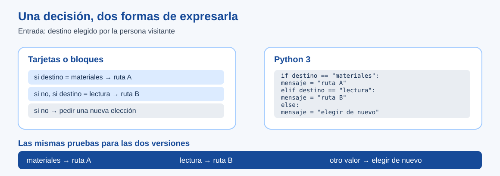

# Del bloque al texto: orientación docente

> Este archivo pertenece a: **B09 Programación**
>
> Ruta: `01. Bloques Temáticos/09. Programación/03. Del Bloque al Texto/README.md`

---

## Estado

**Estado:** En revisión

**Versión:** v0.1

**Bloque:** 09_programacion

**Última actualización:** 2026-11-01

---

## Descripción

Esta carpeta acompaña el paso de una decisión expresada con bloques a una decisión escrita en Python. El punto de partida es un comportamiento conocido: una guía que responde de manera distinta según el destino elegido. El grupo compara entradas y salidas antes de concentrarse en la sintaxis.

El recurso principal se dirige a 7.º–9.º, donde la matriz institucional introduce Python. En 10.º–11.º sirve como diagnóstico o apoyo puntual antes de proyectos con funciones y datos. No exige Python a preescolar o primaria.

## Propósito

Ayudar a reconocer en texto la secuencia, la condición y la respuesta que ya se conocen en bloques; leer un error sin convertirlo en juicio personal; y usar una traza para explicar el primer punto donde la ejecución difiere de lo previsto.

## Contenido

| Recurso | Para qué consultarlo | Evidencia |
| --- | --- | --- |
| [Una regla en bloques y en Python](una-regla-en-bloques-y-en-python.md) | Preparar la comparación sin prometer equivalencias exactas entre interfaces y lenguaje. | Explica qué dato consulta una condición y qué resultado produce. |
| [Práctica: la misma lógica, dos representaciones](practica-misma-logica-dos-lenguajes.md) | Guiar una prueba con tres destinos y una lectura paso a paso. | Predicción, traza de un caso inesperado y un cambio comprobado. |

La [herramienta Python Tutor](../06.%20Herramientas%20para%20el%20Aula/juegos-y-entornos-interactivos.md) permite detener la ejecución y observar el valor de `destino`. Es una opción de aula, no un requisito. En papel, la persona docente puede ocultar una línea cada vez y pedir que el equipo registre el valor antes de continuar.

### Ruta breve de mediación

1. Recupere un proyecto por bloques que el grupo ya pueda explicar.
2. Escriban tres entradas y la respuesta esperada para cada una.
3. Lean el programa en Python y marquen dónde se asigna el dato, dónde se pregunta y dónde se muestra el resultado.
4. Ejecuten un caso por vez; si el programa responde distinto, busquen la primera condición que explica la diferencia.
5. Cambien una parte pequeña y repitan las pruebas previas.

El código de texto puede fallar por indentación o por una condición equivocada. Son problemas distintos. La primera afecta la forma en que Python entiende el bloque; la segunda, la regla que el equipo quiso expresar. No añada mensajes de error artificiales para hacer más vistosa la práctica.

## Aplicación en Maker Academy

### Inspiración

La persona visitante elige un destino, pero la guía muestra la ruta equivocada. Pregunte qué entrada se dio y qué respuesta se esperaba antes de mostrar el texto.

### Experimentación

El equipo representa la regla de dos maneras, ejecuta los tres casos y observa uno paso a paso. Un compañero revisa la predicción y propone una prueba que revele un límite.

### Reflexión y evaluación formativa

Pida explicar una relación concreta entre valor de entrada, condición y salida. La [ficha de evaluación](../07.%20Evaluaci%C3%B3n/registro-de-pruebas.md) conserva el cambio y la nueva prueba. No mida la comprensión por velocidad al teclear.

## Recursos relacionados

- [Programación por Bloques](../02.%20Programaci%C3%B3n%20por%20Bloques/README.md).
- [Mapa K–11](../01.%20Mapa%20de%20Progresi%C3%B3n.md).
- [Juegos y entornos interactivos](../06.%20Herramientas%20para%20el%20Aula/juegos-y-entornos-interactivos.md).
- [Evaluación B09](../07.%20Evaluaci%C3%B3n/README.md).

## Imagen sugerida

El [esquema de dos representaciones](../imagenes/misma-regla-dos-representaciones.svg) sitúa la entrada y tres resultados antes de leer sintaxis. Los rótulos permiten interpretarlo sin color.

## Nota docente

Un estudiante puede reconocer correctamente la decisión y necesitar apoyo para escribir comillas o sangría. Muestre el error real, identifique si es de sintaxis o de lógica y vuelva a preguntar qué esperaba que hiciera el programa.
