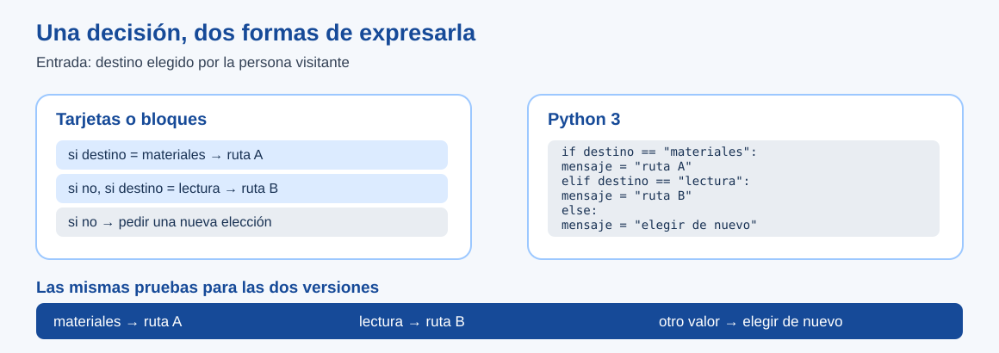

# Una regla en bloques y en Python

> Este archivo pertenece a: **B09 Programación · Del Bloque al Texto**
>
> Ruta: `01. Bloques Temáticos/09. Programación/03. Del Bloque al Texto/una-regla-en-bloques-y-en-python.md`

---

## Estado

**Estado:** En revisión

**Versión:** v0.1

**Bloque:** 09_programacion

**Última actualización:** 2026-11-05

---

## Descripción

La guía del makerspace responde a la elección «materiales», «lectura» u otra cosa. Primero la regla se puede explicar con tarjetas o bloques; después se lee en Python. La relación útil no es que cada bloque tenga una línea idéntica, sino que las **mismas entradas** permitan comprobar si las dos versiones cumplen la intención.

## Propósito

Orientar a docentes para comparar decisiones, anticipar el valor de una variable y distinguir un error de escritura de una regla que produce una salida equivocada. Preparar una transición a texto apropiada para 7.º–9.º.

## Contenido

### 1. La regla antes del lenguaje

Acuerde tres casos con el grupo:

| Entrada del visitante | Respuesta prevista |
| --- | --- |
| `materiales` | «Andá a la mesa de materiales». |
| `lectura` | «Andá a la zona de lectura». |
| Vacía u otra palabra | «Elegí materiales o lectura». |

En tarjetas, una persona toma el dato `destino`, compara las dos opciones y muestra el mensaje correspondiente. En un proyecto por bloques, el evento de pulsar una opción puede traer ese dato o activar directamente una rama. En el programa siguiente, el valor se asigna antes de evaluar las condiciones. **Pulsar un botón** y **asignar una variable** son mecanismos distintos; se comparan por la respuesta que ve la persona usuaria.



### 2. Leer un programa corto

Este ejemplo funciona con Python 3. Cambie solo la primera línea para probar otro caso.

```python
destino = "materiales"

if destino == "materiales":
    mensaje = "Andá a la mesa de materiales"
elif destino == "lectura":
    mensaje = "Andá a la zona de lectura"
else:
    mensaje = "Elegí materiales o lectura"

print(mensaje)
```

`=` asigna un valor; `==` compara dos valores. Python lee el `if` y, si es falso, prueba el `elif`. La rama `else` cubre todos los valores restantes. La sangría indica qué instrucción pertenece a cada rama. `print` muestra el mensaje que quedó asignado. Esta salida en consola representa la respuesta de una guía; no es una interfaz de botones.

En la primera línea, `destino = "materiales"` **guarda** el texto para consultarlo después. En `if destino == "materiales":`, `==` **pregunta** si coinciden los valores y produce verdadero o falso. Escribir `if destino = "materiales":` provoca un error de sintaxis: asignar no equivale a comparar. En bloques, la asignación suele aparecer como «fijar destino a…» y la comparación como una pieza con dos entradas dentro de «si…». Pida señalar ambas operaciones en el ejemplo antes de cambiar una condición.

La sangría de las líneas `mensaje = ...` equivale a colocar instrucciones **dentro de la boca** de cada bloque «si», «si no, si» o «de lo contrario» en Scratch o MakeCode. La línea `print(mensaje)` vuelve al margen porque debe ejecutarse después de elegir una rama. Si se quita la sangría de una instrucción que debería estar dentro de una rama, Python ya no puede interpretar esa estructura como se pretendía; compare visualmente los márgenes antes de ejecutar.

Una persona docente puede preguntar antes de ejecutar: «¿Qué valor tiene `destino`?», «¿se probará la segunda condición?» y «¿qué línea asignará `mensaje`?». Con `destino = "materiales"`, la primera condición es verdadera y se asigna el primer mensaje. No se ejecutan también las ramas siguientes.

### 3. Tres pruebas y un límite visible

Repita el programa cambiando el valor inicial a `"lectura"` y luego a `"otro"`. Las respuestas esperadas son, respectivamente, la zona de lectura y la solicitud de elegir otra vez. Con `"Materiales"` —mayúscula inicial— también se ejecuta `else`: Python compara textos exactamente. El grupo puede decidir más adelante si quiere aceptar variantes de escritura; esta primera versión exige las dos palabras acordadas y deja visible su límite.

| Si observa… | Revise primero… | Comprobación |
| --- | --- | --- |
| `SyntaxError` o `IndentationError`. | Comillas, dos puntos y sangría en la línea indicada por Python. | Vuelva a ejecutar sin cambiar la intención de la regla. |
| Se muestra «materiales» al pedir «lectura». | Qué valor se asignó y qué texto compara cada condición. | Cambie solo la condición incorrecta; pruebe ambos destinos. |
| Se muestra la respuesta genérica con mayúsculas. | Si el texto de entrada coincide exactamente. | Documente este caso como límite; no lo llame «error de Python». |

La redacción del mensaje puede variar sin cambiar la regla. Para demostrar una mejora, conserve el caso que falló y compruebe que los anteriores siguen funcionando.

### 4. Una traza que ayuda a pensar

En [Python Tutor](https://pythontutor.com/visualize.html), pegue solo este ejemplo ficticio, seleccione Python 3 y avance paso a paso. Antes de cada avance, pida al grupo que anticipe `destino`, el resultado de la comparación y el valor de `mensaje`. El visualizador hace visible el estado; no interpreta por qué una ruta sería útil para la persona visitante. Esa decisión sigue siendo del equipo.

Sin conexión, entregue la impresión con las ramas cubiertas por una tira de papel. Un estudiante lee una línea, otro lleva el registro de valores y un tercero decide si la condición se cumple. Esta alternativa permite discutir la misma lógica.

### 5. Cuándo avanzar

Cuando el grupo puede predecir las tres salidas y explicar el límite de las mayúsculas, se puede introducir una forma de recibir la elección desde teclado o una función que agrupe la regla. No agregue ambas cosas de golpe. En 10.º–11.º, las mismas pruebas pueden convertirse en casos automatizados para una función; eso corresponde al desarrollo posterior de **Python con Propósito**.

## Aplicación en Maker Academy

### Inspiración

Recupere la guía por bloques y pregunte qué mensajes verá alguien que no conoce el programa. Las entradas y salidas preceden al código.

### Experimentación

El estudiantado traza una entrada en papel o en Python Tutor, cambia un valor y ejecuta. Otra pareja propone una entrada no prevista y ayuda a comprobar qué rama la atiende.

### Reflexión y evaluación formativa

Pida señalar una línea que determina el resultado y explicar qué ocurriría si cambia el valor. Registre una predicción, la salida real y una mejora o límite reconocido en la [ficha de pruebas](../07.%20Evaluaci%C3%B3n/registro-de-pruebas.md).

## Recursos relacionados

- [Práctica: la misma lógica, dos representaciones](practica-misma-logica-dos-lenguajes.md).
- [Eventos, decisiones y repeticiones](../02.%20Programaci%C3%B3n%20por%20Bloques/eventos-decisiones-y-repeticiones.md).
- [Python Tutor, visualizador oficial](https://pythontutor.com/visualize.html).

## Imagen sugerida

El [esquema comparativo](../imagenes/misma-regla-dos-representaciones.svg) muestra las tres respuestas antes del fragmento de código. No es una captura de un lenguaje o herramienta ajena.

## Nota docente

No traduzca bloque por bloque en voz alta mientras el grupo copia. Pida primero que predigan una salida y señalen qué decisión del texto la causa. Si aparece un error de sangría, use el mensaje del intérprete como pista y conserve la prueba que querían realizar.
