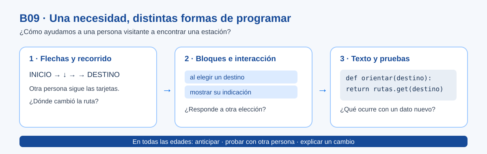

# B09 · Programación

> Este archivo pertenece a: **Programación**

> Ruta: `01. Bloques Temáticos/09. Programación/README.md`

---

## Estado

**Estado:** En revisión

**Versión:** v0.1

**Bloque:** 09_programacion

**Última actualización:** 2026-10-26

---

## Descripción

B09 reúne recursos para enseñar programación como una manera de expresar ideas, crear interacciones y resolver problemas. Comienza con instrucciones que otra persona puede seguir y avanza hacia programas que el estudiantado puede leer, probar y mejorar. La ruta abarca de preescolar a undécimo año, con distintas representaciones y grados de autonomía.

La programación también aparece en [B04 Microcontroladores](../04.%20Microcontroladores/README.md). Allí se aplica a placas, pines, sensores y actuadores. Aquí se estudia la lógica que puede usarse en una historia, un juego, una aplicación o un prototipo físico. Esta división evita enseñar dos veces la conexión de un sensor y dejar sin espacio la prueba de un algoritmo.

## Propósito

Orientar al personal docente para seleccionar retos de programación apropiados al nivel, mediar las decisiones del grupo y reconocer evidencias de comprensión más allá de que el programa «funcione». La [matriz anual K–11](../../02.%20Programa%20Anual%20K11/Matriz%20Anual%20K-11.md) conserva la secuencia institucional: iconografía, bloques, introducción a Python y Python. B09 aporta materiales de consulta para esa trayectoria; su incorporación formal a la progresión de bloques todavía está en revisión.

## Contenido

### Una pregunta para todo el bloque

**¿Cómo sabemos que nuestras instrucciones hacen lo que queríamos y le sirven a otra persona?**

Un visitante del makerspace necesita llegar a una estación. El grupo puede trazar una ruta de flechas, programar un personaje que indique el camino o crear una herramienta de consulta. Lo importante cambia con la edad: en preescolar se prueba el orden; en primaria, un evento o una decisión; en secundaria, la lectura, la depuración y la validación de un programa.

*Figura. La progresión aumenta las posibilidades de representar y probar una idea; no obliga a usar pantalla en los primeros niveles.*

### Cómo recorrer las carpetas

| Carpeta | Para qué sirve | Estado de esta entrega |
| --- | --- | --- |
| [01. Instrucciones y Algoritmos](01.%20Instrucciones%20y%20Algoritmos/README.md) | Secuencia, precisión, predicción y descomposición antes de elegir un entorno. | Desarrollada para revisión. |
| [02. Programación por Bloques](02.%20Programaci%C3%B3n%20por%20Bloques/README.md) | Eventos, decisiones, repeticiones y estados en una creación propia. | Desarrollada para revisión. |
| 03. Del Bloque al Texto | Leer comportamientos equivalentes, interpretar errores y depurar. | Prevista en el [planeamiento](00.%20Planeamiento%20del%20Bloque.md). |
| 04. Python con Propósito | Programas con datos, funciones y decisiones comprobables. | Prevista en el planeamiento. |
| 05. Prácticas y Proyectos | Proyectos integrados, versiones y pruebas con usuarios. | Prevista en el planeamiento. |
| [06. Herramientas para el Aula](06.%20Herramientas%20para%20el%20Aula/README.md) | Elegir Code.org u otro entorno por su utilidad pedagógica y condiciones de acceso. | Desarrollada para revisión. |
| [07. Evaluación](07.%20Evaluaci%C3%B3n/README.md) | Registrar una prueba y retroalimentar sin premiar solo la velocidad. | Desarrollada para revisión. |

Consulte el [mapa de progresión](01.%20Mapa%20de%20Progresi%C3%B3n.md) antes de tomar una actividad de otra edad. El [planeamiento del bloque](00.%20Planeamiento%20del%20Bloque.md) contiene el orden de desarrollo y la relación con B04. Se irán agregando carpetas completas; el índice no enlaza a archivos vacíos.

### Qué se espera de cada recurso

Los documentos conceptuales son consulta docente: explican una decisión, la muestran con un caso y ofrecen preguntas para mediar. Las prácticas indican preparación, tres momentos de XperiencED Maker, pruebas habituales y de fallo, evidencias y adaptaciones. El estudiantado puede usar dibujos, explicaciones orales, bloques o código de texto para mostrar la misma idea con distinta profundidad.

Una actividad de Code.org puede ayudar a explorar un concepto. La meta de Maker Academy se comprueba cuando el grupo puede **predecir, probar, explicar y cambiar** su propia solución, incluso si eligió una herramienta diferente.

## Aplicación en Maker Academy

### Inspiración

Parta de una necesidad cercana y pida al grupo que anticipe una acción: «¿Qué instrucciones necesita quien visita el espacio para llegar al área de construcción?». Permita que propongan rutas distintas.

### Experimentación

Otro equipo sigue las instrucciones sin recibir pistas adicionales. Los autores comparan lo esperado con lo observado, cambian una parte y vuelven a probar. En una pantalla, la persona usuaria prueba la interacción sin que el equipo le explique cada botón.

### Reflexión y evaluación formativa

Conserve una primera versión, una prueba y una mejora. Pregunte **qué cambio tuvo un efecto observable** y qué falta probar. La [orientación de evaluación](07.%20Evaluaci%C3%B3n/README.md) propone evidencias breves; el nivel determina si son orales, visuales o escritas.

## Recursos relacionados

- [Planeamiento de B09](00.%20Planeamiento%20del%20Bloque.md).
- [Mapa de progresión](01.%20Mapa%20de%20Progresi%C3%B3n.md).
- [Matriz Anual K–11](../../02.%20Programa%20Anual%20K11/Matriz%20Anual%20K-11.md).
- [B04 Microcontroladores](../04.%20Microcontroladores/README.md).

## Imagen sugerida

La [ruta visual de B09](imagenes/ruta-programacion-b09.svg) puede proyectarse al presentar el bloque. Mantiene una paleta institucional, etiquetas cortas y tres representaciones de la misma necesidad. El texto alternativo explica la progresión sin depender del color.

## Nota docente

Empiece por el comportamiento que el grupo necesita construir y por la evidencia que permitirá saber si se entendió. Elegir una plataforma antes del reto suele trasladar la conversación a botones y cuentas. Una tarjeta que otro equipo prueba y corrige puede enseñar más sobre programación que completar una pantalla sin poder explicar qué ocurrió.
